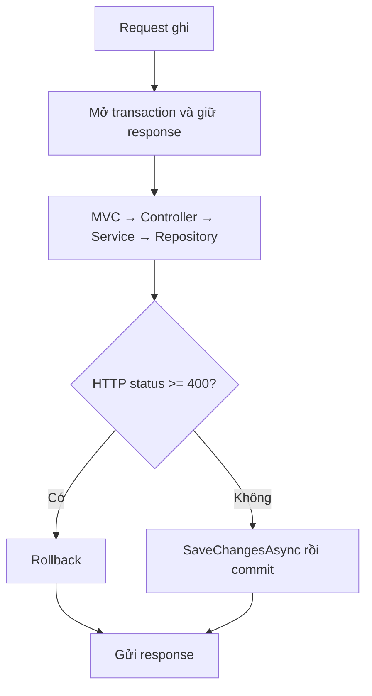

# Hướng dẫn làm việc với INuStore

INuStore là API .NET 10 cho đăng nhập, quản lý user, role và gán role cho user. Ứng dụng dùng EF Core để làm việc với SQL Server. [AGENTS.md](AGENTS.md) là hướng dẫn chính của repository. Các bài giải thích từng chủ đề nằm trong [technical-docs](technical-docs/).

## Tìm code ở đâu

| Project | Trách nhiệm |
| --- | --- |
| `src/INuStore.API/` | Nhận HTTP request, kiểm tra quyền, validate dữ liệu, chạy middleware và trả response. Mở `Program.cs` để xem cách ghép các phần lại với nhau. |
| `src/INuStore.Contract/` | Các kiểu dữ liệu API nhận và trả về cho Auth, User và Role. Đây cũng là nơi định nghĩa `Result` và lỗi validation. |
| `src/INuStore.Domain/` | Các entity `User`, `Role`, `UserRole`, loại role `RoleType` và lỗi nghiệp vụ. |
| `src/INustore.UseCase/` | Service xử lý nghiệp vụ, validator, mapping và interface mà service cần. Đường dẫn project viết `INustore.UseCase`, namespace viết `INuStore.UseCase`. |
| `src/INuStore.Infrastructure/` | Kết nối SQL Server, repository, unit of work, cấu hình entity, migration, băm mật khẩu và sinh JWT. |
| `tests/INuStore.Tests/` | Test đăng nhập, xử lý exception và ranh giới giữa các project. Trong Visual Studio, project này nằm trong solution folder `/tets/`. |

UseCase dùng Domain và Contract. Infrastructure triển khai các interface của UseCase. API đăng ký và kết nối các thành phần. Domain và Contract độc lập với các project còn lại. Contract có sẵn một tham chiếu EF Core phục vụ `PagedResult<T>.CreateAsync`. Xem `ArchitectureTests.cs` khi thay đổi quan hệ giữa các project.

Đăng ký dependency qua `AddInfrastructure(configuration)`, `AddUseCase()` hoặc `AddApi(configuration)` tùy nơi triển khai. `IUserService` và `IRoleService` là scoped, tức dùng chung trong phạm vi một request. Auth service, repository, unit of work, password hasher và JWT service là transient, tức tạo khi DI cấp dependency. UseCase tự tìm validator và AutoMapper profile trong assembly của nó.

## Request chạy và lưu dữ liệu như thế nào

Controller có tiền tố `/api/v1/`. Đọc `[FromQuery]`, `[FromRoute]` và `[FromBody]` để biết dữ liệu đến từ query string, đường dẫn hay JSON body. `[Validate<TModel>]` gọi FluentValidation sau khi MVC dựng tham số. Lỗi validator trả HTTP 400 cùng danh sách lỗi. Lỗi binding hoặc DataAnnotations có thể dùng response 400 mặc định của MVC.

Với POST, PUT, PATCH và DELETE đã qua bước kiểm tra quyền, `TransactionMiddleware` mở transaction trước khi MVC bind và validate dữ liệu. POST login cũng đi qua middleware này. GET bỏ qua transaction.



`Add`, `Update` và `Remove` chuẩn bị thay đổi trong EF. Middleware gọi `IUnitOfWork.SaveChangesAsync` để ghi thay đổi, sau đó commit để hoàn tất transaction. Khi có exception, transaction chưa commit được giải phóng trước khi `ExceptionHandlingMiddleware` trả lỗi. Nếu gọi service ngoài pipeline HTTP này, cần một nơi chịu trách nhiệm lưu dữ liệu. Khi trả `Result` lỗi, ánh xạ sang HTTP status phù hợp. Truy cập `Value` của `Result<T>` thất bại sẽ ném exception.

Middleware, repository và unit of work dùng chung `ApplicationDbContext` của request. Hãy `await` lần lượt các thao tác trên context này, kể cả truy vấn `AsNoTracking()`. `FindAll` dùng no tracking, còn `FindByIdAsync` và `FindSingleAsync` bật tracking. `GetUserWithRolesAsync` tải quan hệ bằng `Include` và `ThenInclude`. Lazy loading đang tắt. [Quy tắc dùng DbContext của EF Core](https://learn.microsoft.com/en-us/ef/core/dbcontext-configuration/#avoiding-dbcontext-threading-issues)

`EFUnitOfWork` chuyển lỗi SQL Server đã nhận diện sang lỗi nghiệp vụ qua `SqlServerExceptionTranslator`, hiện gồm trùng tên role và xóa role đang được gán. Translator đọc mã lỗi, tên constraint trong thông báo và trạng thái entity. Lỗi gốc được giữ trong `InnerException`. Lỗi chưa nhận diện được ném tiếp. Code seed gọi trực tiếp context nên đi ngoài bước chuyển lỗi này. Cấu hình retry được kiểm tra lúc khởi động, nhưng chiến lược retry SQL hiện đang tắt.

Middleware xử lý lỗi trả JSON gồm `title`, `status`, `detail` và `errors`. Sai thông tin đăng nhập trả 401, lỗi yêu cầu nghiệp vụ trả 400, không tìm thấy trả 404, lỗi định dạng trả 422. UseCase `ValidationException` hiện thuộc nhánh 500. `detail` lấy từ `exception.Message`, vì vậy hãy giữ dữ liệu nhạy cảm ngoài thông báo lỗi.

## Auth, user và role hiện hoạt động ra sao

- **Đăng nhập.** `POST /api/v1/Auth/Login` tìm user theo tên và kiểm tra mật khẩu bằng BCrypt. Sai mật khẩu và không có user cùng trả 401. Thành công trả access token HS256 chứa ID, tên user, email và một refresh token ngẫu nhiên. Hiện chưa lưu refresh token hoặc có endpoint dùng refresh token.
- **Kiểm tra quyền.** `AddApi` đăng ký JWT Bearer. `WebApplication` tự thêm middleware authentication và `Program.cs` gọi `UseAuthorization()`. `GetUserById` áp dụng policy `allow-gmail`, yêu cầu đăng nhập và email kết thúc bằng `@gmail.com`. `GetAllUsers`, CRUD role và các API gán role yêu cầu đăng nhập. Login và các action tạo, sửa, xóa user chưa có yêu cầu authorization. JWT kiểm tra hạn dùng và khóa ký. Kiểm tra issuer và audience đang tắt. [Cách ASP.NET Core thêm middleware](https://learn.microsoft.com/en-us/aspnet/core/fundamentals/middleware/?view=aspnetcore-10.0#middleware-added-automatically-by-webapplication)
- **User CRUD.** `CreateUser` tạo một user và ghi đè giá trị tạm mà `UserProfile` map vào `PasswordHash` bằng kết quả băm BCrypt trước khi thêm entity. Giữ mật khẩu và hash ngoài DTO trả về. `GetAllUsers` vẫn lấy toàn bộ danh sách dù nhận tham số phân trang. `GetUserById` yêu cầu `UserId > 7` và trả 404 nếu thiếu user. Update yêu cầu ID dương. Update và delete trả thành công khi không tìm thấy user. Lookup trong delete hiện chưa truyền cancellation token.
- **Role CRUD.** Các action dưới `/api/v1/Role/` trả HTTP 200 cùng `Result` khi thành công. Danh sách sắp theo ID. DTO role chỉ trả thông tin role. Tên role được trim, bắt buộc có giá trị và dài tối đa 256 ký tự. Role có sẵn trong `RoleType` chỉ đổi được mô tả. Role đã gán cho user không được xóa. Ràng buộc tên duy nhất và khóa ngoại cần migration `20261109132818_ProtectRoleNamesAndAssignments`. Xử lý tên trùng trong database trước khi áp dụng.
- **Gán và gỡ một role.** `GET /api/v1/User/{userId}/roles` trả role sắp theo tên. Dùng `PUT` hoặc `DELETE` với `/api/v1/User/{userId}/roles/{roleId}` để gán hoặc gỡ. Các ID phải dương. Khi gán hoặc gỡ, thiếu user hoặc role trả 404. Gửi lại cùng yêu cầu sau khi trạng thái đã đúng vẫn thành công.
- **Thay toàn bộ role.** `PUT /api/v1/User/{userId}/roles` kiểm tra ID trên route và danh sách `roleIds` trong body. Danh sách phải có ít nhất một ID dương và mọi ID đều phải dương. Code hiện lấy các role tìm được để thêm và dùng danh sách gửi lên để tính role cần xóa. Nếu một ID không tồn tại, request vẫn có thể thành công và chỉ lưu một phần danh sách, thậm chí gỡ hết role cũ. Thiếu user trả 404. Các request thay role đồng thời chưa được tuần tự hóa.

## Chạy local và xem API

Chạy trong thư mục gốc bằng .NET 10 SDK.

```powershell
dotnet restore INuStore.slnx
dotnet build INuStore.slnx --no-restore
dotnet test INuStore.slnx --no-build
dotnet run --project src/INuStore.API --launch-profile https
```

Profile HTTPS dùng `https://localhost:7005` và `http://localhost:6000` trong môi trường Development. Mở `/swagger/index.html` hoặc dùng [file .http](src/INuStore.API/INuStore.API.http). Trong Swagger, dán access token vào Authorize. Swagger tự thêm tiền tố `Bearer`. Development hiện gọi `MapOpenApi()` nhưng phần đăng ký service chưa có `AddOpenApi()`. Cần kiểm tra startup khi sửa phần OpenAPI hoặc cấu hình khởi động.

- `/health/live` kiểm tra API có phản hồi.
- `/health/ready` kiểm tra kết nối SQL Server qua EF, với thời gian chờ năm giây.
- Hai endpoint dùng được khi chưa đăng nhập và không có tiền tố version. Kết quả mặc định là text, `200 Healthy` hoặc `503 Unhealthy`. Readiness kiểm tra kết nối, còn schema cần được kiểm tra riêng.

Đặt chuỗi kết nối ở `ConnectionStrings:ConnectionStrings` hoặc qua biến môi trường `ConnectionStrings__ConnectionStrings`. Cấu hình JWT nằm trong `JwtOption`. Giữ thông tin đăng nhập, khóa ký và token thật ngoài source và log. EF đang bật detailed errors và sensitive-data logging. Serilog ghi ra console và file theo ngày trong `logs/`.

## Thay đổi database

Infrastructure chứa migration. API cung cấp cấu hình khởi động cho EF Tool. Dùng `ApplicationDbContext` và kiểm tra `dotnet ef --version` để chọn tool cùng phiên bản chính với EF Core 10. Trong Development, API gọi extension `ApplyMigrationsAsync` của Infrastructure trước khi cấu hình pipeline. Extension dùng `Database.MigrateAsync` để tạo database theo connection string nếu chưa có và áp dụng các migration còn thiếu. SQL Server phải truy cập được; tài khoản kết nối cần quyền tạo database và thay đổi schema tương ứng. Nếu migration lỗi, API dừng khởi động. Các môi trường khác vẫn áp dụng migration qua lệnh hoặc script triển khai riêng.

```powershell
dotnet ef migrations add DescribeSchemaChange --project src/INuStore.Infrastructure --startup-project src/INuStore.API --context ApplicationDbContext -- --environment Development
dotnet ef database update --project src/INuStore.Infrastructure --startup-project src/INuStore.API --context ApplicationDbContext -- --environment Development
```

Lệnh đầu sinh file để review cùng model snapshot. Lệnh sau áp dụng thay đổi vào database đã chọn. Xác nhận đúng database trước khi chạy lệnh sau. Hướng dẫn cho terminal và Package Manager Console nằm trong [tài liệu migration](technical-docs/5.ef-core-migrations.MD).

## Khi sửa và bàn giao

- Đọc source sở hữu hành vi trước khi sửa. Bổ sung contract, service, validator, mapping, controller và DI ở đúng project khi cần. Cập nhật ví dụ `.http` khi đổi endpoint.
- Dùng [.editorconfig](.editorconfig) làm chuẩn trình bày. C# dùng thụt lề bốn dấu cách, file-scoped namespace và dấu ngoặc nhọn trên dòng riêng. Tên type và member public dùng PascalCase, interface bắt đầu bằng `I`, biến và tham số dùng camelCase, field riêng dùng `_camelCase`. Truyền cancellation token cho I/O bất đồng bộ.
- Chỉ tạo, sửa hoặc xóa file test khi người dùng yêu cầu rõ. Khi sửa code, build rồi chạy test sẵn có nếu liên quan. Hiện có tám test, gồm bốn test kiến trúc, ba test login và một test middleware. Muốn xác nhận startup, SQL Server, health check hoặc transaction thì cần kiểm tra riêng. Khi chỉ sửa tài liệu, kiểm tra nội dung, đường dẫn và mục hiển thị trong solution.
- Báo lệnh đã chạy, lỗi, warning và giới hạn xác minh khi bàn giao. Giữ các cảnh báo dependency và bảo mật. `Directory.Build.props` đang có ngoại lệ tạm cho một advisory AutoMapper. Giữ build output, log và test result ngoài Git.
- Viết commit bằng động từ chỉ hành động. Khi tạo PR, giải thích hành vi thay đổi, kiểm tra đã làm, cấu hình hoặc migration liên quan, và ví dụ request/response nếu đổi API.

Dùng Microsoft Learn MCP trong [.codex/config.toml](.codex/config.toml) để tra tài liệu chính thức. Sau khi clone, trust project và mở lại Codex để tải cấu hình. Kiểm tra server bằng `codex mcp list`.
