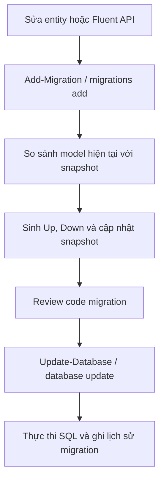

# Hướng dẫn EF Core migration cho INuStore

Tài liệu dành cho người mới, sử dụng .NET 10 và EF Core SQL Server của solution hiện tại. Có hai cách chạy: **Package Manager Console trong Visual Studio** và **terminal dùng dotnet ef**. Chọn một cách cho mỗi thao tác; không cần chạy cả hai.

Các lệnh tạo migration hoặc cập nhật database dưới đây là ví dụ để bạn chủ động chạy sau khi kiểm tra thay đổi. Việc viết tài liệu này không tạo migration, không cập nhật database và không cài hay nâng tool.

## Mục lục

1. [Migration làm gì?](#1-migration-làm-gì)
2. [Project nào nhận migration, project nào khởi động?](#2-project-nào-nhận-migration-project-nào-khởi-động)
3. [Chuẩn bị SDK và tool](#3-chuẩn-bị-sdk-và-tool)
4. [Chọn environment và database](#4-chọn-environment-và-database)
5. [Chạy bằng Package Manager Console](#5-chạy-bằng-package-manager-console)
6. [Chạy bằng terminal với dotnet ef](#6-chạy-bằng-terminal-với-dotnet-ef)
7. [Đọc Up, Down và snapshot](#7-đọc-up-down-và-snapshot)
8. [Remove migration và rollback database](#8-remove-migration-và-rollback-database)
9. [Xuất SQL để kiểm tra hoặc triển khai](#9-xuất-sql-để-kiểm-tra-hoặc-triển-khai)
10. [Kiểm tra model và lịch sử database](#10-kiểm-tra-model-và-lịch-sử-database)
11. [Xử lý lỗi thường gặp](#11-xử-lý-lỗi-thường-gặp)
12. [Quy trình thực tế và bảng tra lệnh](#12-quy-trình-thực-tế-và-bảng-tra-lệnh)

## 1. Migration làm gì?

Migration là các thay đổi schema được lưu thành code C#: tạo bảng, thêm cột, tạo khóa ngoại, index… Ví dụ, thêm entity Role vào code chưa làm bảng Roles xuất hiện trong SQL Server.

Có hai thao tác riêng:

| Thao tác | Package Manager Console | Terminal | Tác động chính |
| --- | --- | --- | --- |
| Sinh code migration từ thay đổi model | `Add-Migration` | `dotnet ef migrations add` | Thêm/cập nhật file trong project |
| Áp dụng migration vào database | `Update-Database` | `dotnet ef database update` | Thực thi các thay đổi schema trên database được cấu hình |

Khi **tạo migration**, EF so sánh model hiện tại với model snapshot của migration trước, không so sánh trực tiếp với các bảng đang có trong database.

Khi **update database**, EF kiểm tra lịch sử migration để xác định migration nào cần chạy. Sửa bảng trực tiếp bằng SQL không tự cập nhật snapshot.



Tham khảo cơ chế tại [EF Core migrations overview](https://learn.microsoft.com/en-us/ef/core/managing-schemas/migrations/).

## 2. Project nào nhận migration, project nào khởi động?

INuStore tách phần persistence và API:

| Thành phần | Giá trị trong repository |
| --- | --- |
| Solution root | `C:/NhatNguyen/my-project/INuStore` |
| Target project: nơi lưu migration | `INuStore.Infrastructure` |
| Startup project: cung cấp cấu hình và DI | `INuStore.API` |
| DbContext | `ApplicationDbContext` |
| Thư mục migration | `C:/NhatNguyen/my-project/INuStore/src/INuStore.Infrastructure/Migrations` |
| Connection string key | `ConnectionStrings:ConnectionStrings` |

EF cần khởi tạo DbContext ở design time để đọc mapping. Infrastructure chứa DbContext và cấu hình entity; API là entry point đăng ký các dependency và đọc configuration. Vì vậy, lệnh dùng Infrastructure làm **target** và API làm **startup**.

Hai tham số dễ nhầm:

| Package Manager Console | Terminal | Ý nghĩa |
| --- | --- | --- |
| `-Project INuStore.Infrastructure` | `--project src/INuStore.Infrastructure` | Project nhận file migration |
| `-StartupProject INuStore.API` | `--startup-project src/INuStore.API` | Project tool dùng để lấy cấu hình khi chạy |
| `-Context ApplicationDbContext` | `--context ApplicationDbContext` | Chọn DbContext |
| `-OutputDir Migrations` | `--output-dir Migrations` | Thư mục tính từ target project, không phải solution root |
| `-Args '--environment Development'` | `-- --environment Development` | Truyền environment cho ứng dụng |

`DbContext` là tên class; `Migrations` là tên thư mục. Startup project không phải là nơi mặc định bạn muốn lưu migration.

Tham khảo [design-time DbContext creation](https://learn.microsoft.com/en-us/ef/core/cli/dbcontext-creation).

## 3. Chuẩn bị SDK và tool

### 3.1. Kiểm tra phiên bản trước khi chạy

Mở PowerShell/terminal:

```powershell
Set-Location 'C:/NhatNguyen/my-project/INuStore'
dotnet --version
dotnet --list-sdks
dotnet ef --version
dotnet tool list --global
dotnet tool list --local
```

Tại thời điểm kiểm tra tài liệu, ngày **2026-11-04**:

| Thành phần | Phiên bản/trạng thái quan sát được |
| --- | --- |
| SDK được chọn | 10.0.300 |
| Target framework | net10.0 |
| EF Core packages trong project | 10.0.14 |
| Microsoft.EntityFrameworkCore.Tools ở API | 10.0.14 |
| dotnet-ef global | 9.0.9 |
| Local tool manifest | Chưa có trong repository |

**dotnet-ef global hiện cũ hơn EF Core của project.** Nên đồng bộ tool về 10.0.14 trước khi dùng CLI. Số phiên bản SDK như 10.0.300 không cần giống số patch của EF như 10.0.14.

### 3.2. Tool cho terminal

Máy hiện đã có dotnet-ef global, nên lệnh cần dùng để đồng bộ là:

```powershell
dotnet tool update --global dotnet-ef --version 10.0.14
dotnet ef --version
```

Nếu dùng máy khác **chưa cài tool**, dùng install thay cho update:

```powershell
dotnet tool install --global dotnet-ef --version 10.0.14
```

Global tool được cài cho user Windows và dùng chung giữa các repository. Repository hiện không có local tool manifest; `dotnet tool restore` không thay thế bước cài/cập nhật global tool trong hướng dẫn này.

Tham khảo cách cài và cập nhật tại [EF Core CLI tools](https://learn.microsoft.com/en-us/ef/core/cli/dotnet); phiên bản được dùng trong bài là [dotnet-ef 10.0.14](https://www.nuget.org/packages/dotnet-ef/10.0.14).

### 3.3. Tool cho Package Manager Console

Trong Visual Studio, mở:

**Tools → NuGet Package Manager → Package Manager Console**

Kiểm tra:

```powershell
Get-Help about_EntityFrameworkCore
Get-Package -ProjectName INuStore.API | Where-Object { $_.Id -eq 'Microsoft.EntityFrameworkCore.Tools' }
```

API hiện đã tham chiếu Tools 10.0.14, nên không cần cài lại. Nếu package bị thiếu trên một checkout khác, có thể cài trong PMC:

```powershell
Install-Package Microsoft.EntityFrameworkCore.Tools -Version 10.0.14 -ProjectName INuStore.API
```

PMC dùng package `Microsoft.EntityFrameworkCore.Tools`; terminal dùng executable `dotnet-ef`. Cập nhật một bên không đồng nghĩa cập nhật bên còn lại.

API hiện cũng có dependency Design 10.0.14 được kéo qua Tools. Nếu CLI báo startup project thiếu `Microsoft.EntityFrameworkCore.Design`, kiểm tra restore/package graph; trường hợp cần tham chiếu trực tiếp thì thêm Design đúng phiên bản vào API.

Tham khảo [EF Core Package Manager Console tools](https://learn.microsoft.com/en-us/ef/core/cli/powershell).

## 4. Chọn environment và database

Connection string hiện được khai báo trong [appsettings.Development.json](/C:/NhatNguyen/my-project/INuStore/src/INuStore.API/appsettings.Development.json), với cấu trúc key:

```json
{
  "ConnectionStrings": {
    "ConnectionStrings": "<connection string của database cần dùng>"
  }
}
```

Đây là ví dụ cấu trúc; không thay file hiện có bằng riêng đoạn JSON này vì file còn các cấu hình khác.

Các lệnh bên dưới truyền rõ `Development` để đọc cấu hình này. Không dựa vào launch profile của `dotnet run` để mặc định rằng `dotnet ef` cũng dùng cùng environment.

Có thể ghi đè connection string trong **session PowerShell/PMC hiện tại**:

```powershell
$env:ConnectionStrings__ConnectionStrings = 'Server=localhost;Database=INuStore_Local;Trusted_Connection=True;TrustServerCertificate=True'
```

Đây là ví dụ dùng SQL Server local và Windows authentication; thay server/database bằng instance thực tế của bạn. `TrustServerCertificate=True` trong ví dụ phục vụ môi trường local.

Dấu `__` trong biến môi trường tương ứng với dấu `:` trong configuration key. Biến này được ưu tiên hơn giá trị cùng key trong appsettings. Không chép connection string có mật khẩu thật vào tài liệu hoặc commit.

Khi muốn bỏ giá trị ghi đè của session:

```powershell
Remove-Item Env:ConnectionStrings__ConnectionStrings
```

Trước Update-Database, kiểm tra server/database và credential thực tế đang được chọn, kể cả giá trị đã ghi đè bằng environment. SQL Server cần truy cập được và tài khoản phải có quyền phù hợp.

Tham khảo [ASP.NET Core configuration](https://learn.microsoft.com/en-us/aspnet/core/fundamentals/configuration/?view=aspnetcore-10.0#environment-variables).

## 5. Chạy bằng Package Manager Console

### 5.1. Chuẩn bị trong Visual Studio

Mở solution, đặt Startup Project là `INuStore.API`; trong PMC chọn Default project là `INuStore.Infrastructure`.

Dù đã chọn trên UI, các lệnh mẫu vẫn ghi rõ `-Project` và `-StartupProject` để tránh chạy nhầm khi đổi lựa chọn.

Build solution trước. Nếu cần dùng dotnet từ PMC:

```powershell
Set-Location 'C:/NhatNguyen/my-project/INuStore'
dotnet restore INuStore.slnx
dotnet build INuStore.slnx --no-restore
```

### 5.2. Kiểm tra DbContext

```powershell
Get-DbContext -Project INuStore.Infrastructure -StartupProject INuStore.API -Context ApplicationDbContext -Args '--environment Development'
```

Lệnh giúp phát hiện sớm lỗi khởi tạo context/model. Nó không chứng minh tài khoản SQL có đủ quyền để thay đổi schema.

### 5.3. Xem các migration trong code, chưa kết nối database

```powershell
Get-Migration -Project INuStore.Infrastructure -StartupProject INuStore.API -Context ApplicationDbContext -NoConnect -Args '--environment Development'
```

`-NoConnect` cho phép liệt kê migration mà không truy vấn database. Vì thế không dùng kết quả này để kết luận migration đã được áp dụng hay chưa.

### 5.4. Tạo migration mới sau khi sửa model

```powershell
Add-Migration DescribeSchemaChange -Project INuStore.Infrastructure -StartupProject INuStore.API -Context ApplicationDbContext -OutputDir Migrations -Args '--environment Development'
```

Thay `DescribeSchemaChange` bằng tên mô tả thay đổi thực tế, ví dụ `AddRoleCode` khi bạn thực sự thêm Role.Code. Tên migration là nhãn mô tả; EF sinh nội dung từ thay đổi model, không từ tên bạn đặt.

Repository đã có migration `CreateRoleTable`; không tạo lại cùng tên để áp dụng migration đó. Muốn áp dụng migration đã có thì chuyển sang bước update.

### 5.5. Review rồi áp dụng vào database

Kiểm tra `Up`, `Down`, file Designer và snapshot trước. Sau đó:

```powershell
Update-Database -Project INuStore.Infrastructure -StartupProject INuStore.API -Context ApplicationDbContext -Args '--environment Development'
```

Không truyền tên migration nghĩa là cập nhật đến migration cuối cùng trong code. Nếu database đã ở đúng phiên bản thì không chạy lại các migration đã ghi nhận. Nếu database local chưa tồn tại, EF có thể tạo database khi tài khoản có đủ quyền; vẫn phải kiểm tra đúng server và tên database trước khi chạy.

### 5.6. Kiểm tra trạng thái áp dụng

```powershell
Get-Migration -Project INuStore.Infrastructure -StartupProject INuStore.API -Context ApplicationDbContext -Args '--environment Development'
```

Lần này không có `-NoConnect`, tool có thể kết nối database để lấy trạng thái applied. Cấu hình kết nối vẫn phải trỏ đúng database cần kiểm tra.

## 6. Chạy bằng terminal với dotnet ef

Các ví dụ dùng PowerShell ở solution root. Terminal có thể là Windows Terminal, terminal của VS Code hoặc terminal tích hợp Visual Studio; `Add-Migration` không phải lệnh có sẵn của terminal PowerShell thông thường.

### 6.1. Restore và build

```powershell
Set-Location 'C:/NhatNguyen/my-project/INuStore'
dotnet restore INuStore.slnx
dotnet build INuStore.slnx --no-restore
```

### 6.2. Kiểm tra DbContext

```powershell
dotnet ef dbcontext info --project src/INuStore.Infrastructure --startup-project src/INuStore.API --context ApplicationDbContext -- --environment Development
```

### 6.3. Xem migration trong code

```powershell
dotnet ef migrations list --project src/INuStore.Infrastructure --startup-project src/INuStore.API --context ApplicationDbContext --no-connect -- --environment Development
```

### 6.4. Tạo migration mới

```powershell
dotnet ef migrations add DescribeSchemaChange --project src/INuStore.Infrastructure --startup-project src/INuStore.API --context ApplicationDbContext --output-dir Migrations -- --environment Development
```

`--output-dir Migrations` tạo file trong Infrastructure/Migrations. Sau dấu `--`, các đối số được chuyển cho ứng dụng; vì thế `--environment Development` phải nằm cuối như ví dụ.

### 6.5. Review rồi cập nhật database

```powershell
dotnet ef database update --project src/INuStore.Infrastructure --startup-project src/INuStore.API --context ApplicationDbContext -- --environment Development
```

### 6.6. Xem trạng thái đã áp dụng

```powershell
dotnet ef migrations list --project src/INuStore.Infrastructure --startup-project src/INuStore.API --context ApplicationDbContext -- --environment Development
```

CLI thường tự build trước các lệnh EF. Chỉ dùng `--no-build` khi đã build đúng phiên bản code vừa sửa; dùng binary cũ có thể khiến bạn tưởng EF không thấy thay đổi model.

## 7. Đọc Up, Down và snapshot

Trong repository hiện có:

- [InitialCreate](/C:/NhatNguyen/my-project/INuStore/src/INuStore.Infrastructure/Migrations/20261027165154_InitialCreate.cs).
- [CreateRoleTable](/C:/NhatNguyen/my-project/INuStore/src/INuStore.Infrastructure/Migrations/20261104150510_CreateRoleTable.cs).
- [ApplicationDbContextModelSnapshot](/C:/NhatNguyen/my-project/INuStore/src/INuStore.Infrastructure/Migrations/ApplicationDbContextModelSnapshot.cs).

`CreateRoleTable.Up()` tạo Roles, UserRoles, khóa ngoại và index. `Down()` xóa UserRoles trước rồi mới xóa Roles để xử lý thứ tự phụ thuộc.

| File/thành phần | Vai trò |
| --- | --- |
| Migration .cs, phương thức Up | Các thao tác khi đi lên phiên bản đó |
| Migration .cs, phương thức Down | Các thao tác khi quay lại phiên bản trước |
| Migration .Designer.cs | Metadata của model tại migration đó |
| ApplicationDbContextModelSnapshot.cs | Model của migration mới nhất trong code, phục vụ lần so sánh tiếp theo |

Snapshot cập nhật khi sinh/remove migration; nó không phản ánh riêng trạng thái từng database. Máy A và máy B có thể cùng source code nhưng áp dụng migration đến các mốc khác nhau.

Nếu bạn đổi tên một property, xem kỹ migration có đang `DropColumn` rồi `AddColumn` hay không. Có trường hợp ý định đúng là `RenameColumn` để giữ dữ liệu. Commit migration, Designer và snapshot cùng thay đổi model liên quan; không chỉnh snapshot để giả lập rằng database đã được update.

Tham khảo [quản lý và review migration](https://learn.microsoft.com/en-us/ef/core/managing-schemas/migrations/managing).

## 8. Remove migration và rollback database

### 8.1. Migration cuối chưa được áp dụng

Nếu vừa tạo sai migration cuối cùng và chưa áp dụng nó vào database dùng chung, remove bằng tool:

PMC:

```powershell
Remove-Migration -Project INuStore.Infrastructure -StartupProject INuStore.API -Context ApplicationDbContext -Args '--environment Development'
```

Terminal:

```powershell
dotnet ef migrations remove --project src/INuStore.Infrastructure --startup-project src/INuStore.API --context ApplicationDbContext -- --environment Development
```

Tool loại bỏ migration cuối và điều chỉnh snapshot. Lệnh có thể kiểm tra database để xác định migration đã được áp dụng hay chưa. Nó không phải lệnh để xóa tùy ý một migration ở giữa lịch sử.

### 8.2. Migration đã áp dụng vào database local

Nếu muốn bỏ `CreateRoleTable` trên database local để làm lại, cần rollback database về migration trước trước khi remove code.

PMC:

```powershell
Update-Database -Migration 20261027165154_InitialCreate -Project INuStore.Infrastructure -StartupProject INuStore.API -Context ApplicationDbContext -Args '--environment Development'
Remove-Migration -Project INuStore.Infrastructure -StartupProject INuStore.API -Context ApplicationDbContext -Args '--environment Development'
```

Terminal:

```powershell
dotnet ef database update 20261027165154_InitialCreate --project src/INuStore.Infrastructure --startup-project src/INuStore.API --context ApplicationDbContext -- --environment Development
dotnet ef migrations remove --project src/INuStore.Infrastructure --startup-project src/INuStore.API --context ApplicationDbContext -- --environment Development
```

Chỉ chạy dòng remove nếu rollback đã thành công. Ví dụ này chạy Down của CreateRoleTable, nên dữ liệu trong Roles/UserRoles sẽ bị mất khi các bảng bị xóa. Chạy lại Up không phục hồi các bản ghi đã mất.

Target `0` nghĩa là rollback tất cả migration; đây không phải lựa chọn mặc định để sửa lỗi. Không cần drop cả database chỉ để thêm một migration.

Với migration đã áp dụng vào database chung/test/production, giữ lịch sử và thường tạo migration mới để sửa. Có thể dùng `-Force` hoặc `--force` trong các tình huống phù hợp, nhưng hướng dẫn này dùng rollback và remove riêng để nhìn rõ tác động.

Tham khảo [remove và rollback migration](https://learn.microsoft.com/en-us/ef/core/managing-schemas/migrations/managing#remove-a-migration).

## 9. Xuất SQL để kiểm tra hoặc triển khai

Sinh script không áp dụng các thay đổi schema vào database. Ví dụ sau tạo script idempotent từ migration đầu đến `CreateRoleTable`.

Tạo thư mục chứa script trước, dùng được trong PowerShell và PMC:

```powershell
New-Item -ItemType Directory -Path 'C:/NhatNguyen/my-project/INuStore/artifacts' -Force | Out-Null
```

PMC:

```powershell
Script-Migration -From 0 -To CreateRoleTable -Idempotent -Output 'C:/NhatNguyen/my-project/INuStore/artifacts/ef-migrations.sql' -Project INuStore.Infrastructure -StartupProject INuStore.API -Context ApplicationDbContext -Args '--environment Development'
```

Terminal:

```powershell
dotnet ef migrations script 0 CreateRoleTable --idempotent --output artifacts/ef-migrations.sql --project src/INuStore.Infrastructure --startup-project src/INuStore.API --context ApplicationDbContext -- --environment Development
```

`Idempotent` nghĩa là script kiểm tra lịch sử migration và chỉ chạy các migration còn thiếu. Nó không tự sửa mọi database bị thay đổi schema thủ công. Đọc SQL trước khi thực thi.

Nếu chỉ muốn SQL từ InitialCreate đến CreateRoleTable, thay `0` bằng `InitialCreate`; database nhận script cần ở trạng thái phù hợp với phạm vi đó.

Khi triển khai production, chọn SQL script đã review nếu cần kiểm soát từng câu SQL, hoặc migration bundle trong quy trình triển khai. Với local development, Update-Database/database update tiện hơn. Áp dụng production cần kiểm tra tác động dữ liệu và phương án phục hồi; Down không thay thế backup.

Tham khảo [các cách áp dụng migration](https://learn.microsoft.com/en-us/ef/core/managing-schemas/migrations/applying).

## 10. Kiểm tra model và lịch sử database

### 10.1. Code còn thay đổi model chưa có migration không?

Sau khi đồng bộ CLI lên EF 10, có thể chạy:

```powershell
dotnet ef migrations has-pending-model-changes --project src/INuStore.Infrastructure --startup-project src/INuStore.API --context ApplicationDbContext -- --environment Development
```

Lệnh so sánh model hiện tại với snapshot. Nó không trả lời database đã chạy hết các migration trong code chưa. Khi có model changes chưa được ghi nhận, lệnh báo lỗi/trạng thái không thành công để bạn tạo migration phù hợp.

### 10.2. Database đã chạy migration nào?

Dùng Get-Migration/migrations list **không có NoConnect**, hoặc kết nối đúng database bằng SSMS hay SQL client bạn đang sử dụng rồi đọc:

```sql
SELECT DB_NAME() AS CurrentDatabase;

SELECT MigrationId, ProductVersion
FROM dbo.__EFMigrationsHistory
ORDER BY MigrationId;
```

Bảng lịch sử mặc định lưu migration đã áp dụng và phiên bản EF tương ứng. Database chưa từng được migrate có thể chưa có bảng này. Có file migration trong Git không chứng minh database đã áp dụng file đó.

Tham khảo [migrations has-pending-model-changes](https://learn.microsoft.com/en-us/ef/core/cli/dotnet#dotnet-ef-migrations-has-pending-model-changes).

## 11. Xử lý lỗi thường gặp

### Add-Migration không được nhận diện

Nếu đang ở terminal PowerShell thông thường, dùng `dotnet ef migrations add`. Nếu đang ở PMC, kiểm tra package Tools của API và mở lại PMC sau khi restore/install package nếu cần.

### No project was found hoặc migrations tạo sai project

CLI: về đúng solution root và ghi rõ `--project`, `--startup-project`. PMC: kiểm tra Default project/Startup Project và ghi rõ hai tham số tương ứng.

### Tools version 9.x cũ hơn runtime 10.x

Dùng lệnh update global tool tại mục 3.2 rồi kiểm tra lại `dotnet ef --version`. Nếu kết quả vẫn khác, kiểm tra local manifest hoặc PATH đang chọn executable nào.

### Connection string chưa được khởi tạo, không kết nối được SQL Server

Kiểm tra `--environment Development`/`-Args '--environment Development'` vì connection string hiện nằm trong file Development. Sau đó kiểm tra key `ConnectionStrings:ConnectionStrings`, biến môi trường ghi đè, server/instance, database và quyền truy cập.

Không suy luận rằng database đúng chỉ vì lệnh build thành công. Build kiểm tra code; kết nối và quyền SQL là bước khác.

### NU1903 của AutoMapper và ErrorActionPreference = Stop

NU1903 báo package có lỗ hổng mức High. Tool PowerShell có thể dừng khi thông báo được xử lý qua error stream trong chế độ Stop; điều đó không có nghĩa mọi warning đều tự thành compiler error.

[Directory.Build.props](/C:/NhatNguyen/my-project/INuStore/Directory.Build.props) hiện có ngoại lệ tạm thời cho advisory `GHSA-rvv3-g6hj-g44x`. Ngoại lệ chỉ bỏ qua advisory đó, không vá AutoMapper. Khi nâng lên phiên bản đã vá, xóa ngoại lệ. Không tắt toàn bộ NuGet audit hoặc đặt Ignore cho mọi lỗi để che các lỗi build thực sự.

Tham khảo [NuGet Audit và suppress advisory cụ thể](https://learn.microsoft.com/en-us/nuget/concepts/auditing-packages#excluding-advisories).

### Unable to create a DbContext / navigation property is not virtual

Đọc exception bên trong, ví dụ `Role.UserRoles is not virtual`. Trong cấu hình hiện tại, Infrastructure đã dùng `UseLazyLoadingProxies(false)`, nên lazy-loading proxy không yêu cầu navigation virtual.

Nếu bật lại lazy-loading proxies, các navigation liên quan phải đáp ứng điều kiện proxy. Với User/Role/UserRole, cần xem cả User.UserRoles, Role.UserRoles, UserRole.User và UserRole.Role. Chỉ thêm constructor/factory hoặc đổi tên migration không sửa được lỗi navigation này.

Tham khảo [tài liệu loading nội bộ](/C:/NhatNguyen/my-project/INuStore/Docs/4.ef-core-loading.MD) và [EF lazy-loading proxies](https://learn.microsoft.com/en-us/ef/core/querying/related-data/lazy).

### Model có thay đổi nhưng Update-Database không chạy được

Review thay đổi model, tạo migration rồi review trước khi update. Không tắt kiểm tra pending model changes để thay cho việc sinh migration còn thiếu.

Nếu Add-Migration sinh migration rỗng, kiểm tra: đã sửa đúng model chưa, snapshot đã chứa thay đổi chưa, command có chọn đúng context/project không, có dùng binary cũ với `--no-build` không.

### Build failed hoặc file output đang bị khóa

Chạy `dotnet build INuStore.slnx --no-restore` để xem lỗi đầu tiên. Nếu API/debugger đang giữ DLL thì dừng đúng phiên debug của project rồi build lại. Sửa lỗi được báo trước khi chạy EF tiếp; không xóa migration hoặc database để xử lý lỗi compile.

## 12. Quy trình thực tế và bảng tra lệnh

Một lượt làm việc thông thường:

1. Chọn đúng phiên bản tool, environment và database.
2. Sửa entity/Fluent API theo thay đổi cần làm.
3. Build; tạo migration bằng **một** trong hai công cụ.
4. Review migration và snapshot, nhất là drop/rename, khóa ngoại, index và nullability.
5. Apply vào database local đã chọn; kiểm tra migration history và hành vi liên quan.
6. Commit thay đổi model, migration, Designer và snapshot cùng nhau.

Bảng sau chỉ ghi phần tên lệnh; khi chạy trong INuStore, bổ sung project/startup/context/environment như các ví dụ đầy đủ bên trên.

| Mục đích | Package Manager Console | Terminal |
| --- | --- | --- |
| Kiểm tra context | `Get-DbContext` | `dotnet ef dbcontext info` |
| Xem migrations và trạng thái DB | `Get-Migration` | `dotnet ef migrations list` |
| Chỉ xem migrations trong code | `Get-Migration -NoConnect` | `dotnet ef migrations list --no-connect` |
| Tạo migration | `Add-Migration DescribeSchemaChange` | `dotnet ef migrations add DescribeSchemaChange` |
| Áp dụng đến mới nhất | `Update-Database` | `dotnet ef database update` |
| Đưa DB đến một mốc | `Update-Database -Migration InitialCreate` | `dotnet ef database update InitialCreate` |
| Remove migration cuối | `Remove-Migration` | `dotnet ef migrations remove` |
| Xuất script | `Script-Migration -Idempotent` | `dotnet ef migrations script --idempotent` |
| Tìm model changes chưa có migration | Không có lệnh PMC tương đương trực tiếp trong bộ lệnh EF 10 | `dotnet ef migrations has-pending-model-changes` |

**Những gì đã kiểm tra khi viết tài liệu:** source code, vị trí migration, package references, SDK và phiên bản tool. Trạng thái áp dụng migration trên SQL Server chưa được kiểm tra. Các lệnh tạo/apply/rollback migration trong bài chưa được thực thi.
