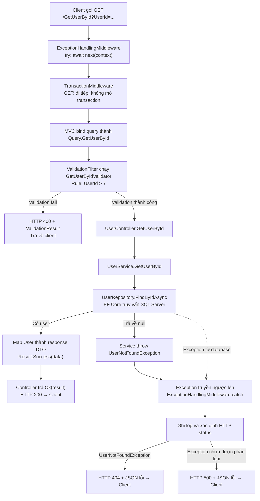

Theo code hiện tại, có ba nhánh chính. **FluentValidation fail được filter trả HTTP 400 trực tiếp; exception từ service/database mới được `ExceptionHandlingMiddleware` bắt.**



**1. Thành công — ví dụ `UserId=8` và user tồn tại**

- Validator kiểm tra `8 > 7`, hợp lệ nên gọi `await next()` để chạy action.
- Controller gọi service; service lấy user qua repository.
- Service chuyển entity thành DTO và trả `Result.Success(data)`.
- Controller trả `Ok(result)`: HTTP **200**, chứa dữ liệu user.

Đoạn xử lý nằm trong [UserService.cs](/C:/NhatNguyen/my-project/INuStore/src/INustore.UseCase/UseCases/V1/UserService/UserService.cs:25).

**2. Không tìm thấy — ví dụ `UserId=9999` và user không tồn tại**

ID vượt qua validation, nhưng repository trả `null`. Service thực hiện:

```csharp
throw new UserException.UserNotFoundException(request.UserId);
```

Exception truyền ngược qua controller và filter. [ExceptionHandlingMiddleware](/C:/NhatNguyen/my-project/INuStore/src/INuStore.API/Middlewares/ExceptionHandlingMiddleware.cs:49) bắt lỗi, ghi log và trả HTTP **404** cùng JSON `{ title, status, detail, errors }`. Exception khác chưa được phân loại sẽ trả **500**.

**3. FluentValidation fail — ví dụ `UserId=3`**

Rule hiện tại yêu cầu `UserId > 7`, nên filter gán:

```csharp
context.Result = new BadRequestObjectResult(
    ValidationResult.WithErrors(errors));
return;
```

Filter không gọi `next()`, vì vậy **action, service và truy vấn database không chạy**. Đây là cách action filter dừng xử lý trước action. [Tài liệu ASP.NET Core](https://learn.microsoft.com/en-us/aspnet/core/mvc/controllers/filters?view=aspnetcore-10.0#action-filters).

Request vẫn đi qua middleware bên ngoài, nhưng **không vào `catch`** vì filter trả response bình thường, không `throw`.