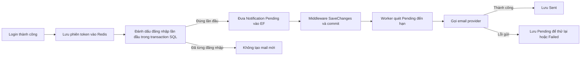

# Flow gửi welcome email khi đăng nhập lần đầu

## Vấn đề và cách project đang giải quyết

Welcome email trong INuStore được tạo khi **đăng nhập thành công lần đầu**, không phải khi đăng ký. Request đăng nhập cần trả token mà không phải chờ dịch vụ email. Nếu gọi email provider ngay trong request, lỗi mạng có thể làm đăng nhập thất bại; nếu gửi email sau khi lưu user nhưng không lưu yêu cầu gửi, tiến trình dừng có thể làm mất email. Vì vậy project lưu một bản ghi `Notifications` trạng thái `Pending`, rồi để worker gửi sau.

`Notifications` đóng vai trò hàng đợi bền vững trong SQL Server: mỗi hàng chứa người nhận, tiêu đề, nội dung HTML, trạng thái và lịch thử lại. Đây là cách làm **giống transactional outbox cho riêng email**: trạng thái đăng nhập lần đầu và yêu cầu gửi được commit trong cùng transaction SQL. Nó chưa phải luồng publish event sang message broker. [Microsoft Learn giải thích bài toán lưu thay đổi nghiệp vụ và yêu cầu phát thông điệp cùng transaction](https://learn.microsoft.com/dotnet/architecture/microservices/architect-microservice-container-applications/asynchronous-message-based-communication#resiliently-publishing-to-the-event-bus).

## Code hiện tại chạy như thế nào?

1. [`AuthService.LoginAsync`](../src/INustore.UseCase/UseCases/V1/AuthService/AuthService.cs) kiểm tra mật khẩu, tạo token, lưu phiên token vào Redis, rồi gọi `FirstLoginNotificationService.ScheduleAsync`. Nhánh `RegisterAsync` chỉ tạo user; nó không tạo welcome email.
2. [`UserRepository.TryMarkFirstLoginAsync`](../src/INuStore.Infrastructure/Repositories/UserRepository.cs) chạy `ExecuteUpdateAsync` với điều kiện `FirstLoggedInAtUtc == null` và `CreatedAtUtc != null`. Chỉ request cập nhật được một hàng mới đi tiếp. `ExecuteUpdateAsync` gửi lệnh SQL **ngay tại lời gọi**, nhưng transaction của request chưa commit; nếu transaction rollback thì thay đổi này cũng rollback. [Microsoft Learn về `ExecuteUpdate` và transaction](https://learn.microsoft.com/ef/core/saving/execute-insert-update-delete#transactions).
3. [`FirstLoginNotificationService.ScheduleAsync`](../src/INustore.UseCase/UseCases/V1/NotificationService/FirstLoginNotificationService.cs) render `Welcome.html`, thay `{{UserName}}` bằng giá trị đã HTML encode và gọi `NotificationRepository.Add`. `Add` chỉ đưa entity vào EF change tracker; **chưa INSERT** hàng notification.
4. [`TransactionMiddleware`](../src/INuStore.API/Middlewares/TransactionMiddleware.cs) gọi `SaveChangesAsync` rồi commit khi response thành công. Lúc này hàng `Notifications` và dấu đăng nhập lần đầu cùng được lưu. Nếu lỗi xảy ra trước commit hoặc lưu DB thất bại, transaction rollback; không có notification để worker gửi. Email provider không tham gia transaction này.
5. Worker riêng dùng [Hangfire recurring job](../src/INuStore.NotificationWorker/DependencyInjection/Extensions/RecurringJobExtensions.cs) để gọi `SendPendingNotificationsJob`. Job gọi [`PendingNotificationService.SendDueEmailsAsync`](../src/INustore.UseCase/UseCases/V1/NotificationService/PendingNotificationService.cs) với tối đa 20 hàng mỗi lượt. [`NotificationRepository.GetDueAsync`](../src/INuStore.Infrastructure/Repositories/NotificationRepository.cs) đọc các email `Pending` đã đến `NextAttemptAtUtc`, theo thứ tự tạo.
6. Worker đọc `EmailProvider` từ application parameter, chọn Resend hoặc SES, gửi email, rồi lưu `SentAtUtc`, `ProviderMessageId` và trạng thái `Sent`. Nếu lỗi gửi thông thường, nó tăng `AttemptCount`, hẹn lại sau 5 phút và chuyển `Failed` khi đạt 5 lần. Thay đổi của từng notification được `SaveChangesAsync` sau khi xử lý hàng đó. Worker không chạy qua HTTP `TransactionMiddleware`.

Hangfire được cấu hình cron `*/6 * * * * *` và lịch poll 1 giây trong [`ServiceCollectionExtensions`](../src/INuStore.NotificationWorker/DependencyInjection/Extensions/ServiceCollectionExtensions.cs). Đây là **cấu hình mong muốn**, không phải cam kết email luôn đến sau 6 giây: worker phải đang chạy, job có thể chậm và provider cũng có độ trễ. Hangfire lưu **lịch/job** trong SQL Server; bảng `Notifications` mới là nơi lưu **từng yêu cầu gửi email**. [Tài liệu Hangfire về recurring job](https://docs.hangfire.io/en/latest/background-methods/performing-recurrent-tasks.html).

Ví dụ: user vừa đăng ký có `FirstLoggedInAtUtc = null`. Lần đăng nhập hợp lệ đầu tiên tạo một hàng `Pending` với `EventType = FirstLogin`. Lần đăng nhập tiếp theo không tạo hàng mới vì lệnh cập nhật trả về 0 hàng. Nếu một user cũ có `CreatedAtUtc = null`, điều kiện hiện tại cũng không tạo welcome email. `Sent` chỉ có nghĩa lời gọi đến provider thành công và trạng thái đã lưu; nó không chứng minh email đã vào hộp thư người nhận.

## Cách này có phù hợp không? Có thể làm cách khác không?

**Có, phù hợp với nhu cầu hiện tại** khi muốn request đăng nhập không chờ email, muốn lưu yêu cầu gửi qua lần restart và số lượng email còn đủ nhỏ để quét SQL theo lô. Đây là nhận định từ thiết kế hiện tại, chưa có benchmark tải của project. Đổi lại, cần vận hành worker, theo dõi hàng `Pending`/`Failed` và chấp nhận email đến sau đăng nhập.

| Cách | Lợi ích | Giới hạn và khi cân nhắc |
| --- | --- | --- |
| Gửi trực tiếp trong `LoginAsync` | Ít thành phần, dễ đọc | Request chờ provider; lỗi email ảnh hưởng login. Chỉ hợp khi nghiệp vụ bắt buộc biết kết quả gửi ngay. |
| Đẩy vào hàng đợi trong bộ nhớ của `BackgroundService` | Không cần bảng/job riêng; phù hợp tác vụ có thể mất | Nếu tiến trình dừng, phần việc chưa lưu bền vững có thể mất. Chỉ dùng khi mất welcome email chấp nhận được hoặc vẫn có nguồn bền vững để quét lại. [Microsoft Learn về hosted service](https://learn.microsoft.com/aspnet/core/fundamentals/host/hosted-services?view=aspnetcore-10.0). |
| **Bảng `Notifications` + worker hiện tại** | Yêu cầu gửi được lưu cùng thay đổi SQL; có trạng thái và retry | Poll SQL, cần worker và cơ chế chống gửi trùng/giám sát tốt hơn khi mở rộng. |
| Message broker + transactional outbox | Tách tải gửi mail khỏi DB polling và hỗ trợ nhiều consumer | Thêm broker, publisher, vận hành và xử lý trùng lặp. Cân nhắc khi lưu lượng lớn hoặc nhiều service cùng cần sự kiện. [Microsoft Learn về outbox](https://learn.microsoft.com/dotnet/architecture/microservices/architect-microservice-container-applications/asynchronous-message-based-communication#resiliently-publishing-to-the-event-bus). |

Chỉ gọi `Hangfire.Enqueue` sau khi commit user cũng không tự giải quyết tính nguyên tử: DB commit thành công nhưng enqueue thất bại thì vẫn mất yêu cầu gửi. Bảng notification hiện tại tránh khoảng hở đó bằng cách lưu yêu cầu trong chính transaction SQL.

## Best practices cho production

- **Chưa thể hứa gửi đúng một lần.** Nếu provider đã nhận email nhưng worker dừng trước khi lưu `Sent`, hàng vẫn là `Pending` và lượt sau có thể gửi lại. Code Resend truyền `Notification.Id` làm idempotency key; code SES nhận tham số này nhưng chưa dùng khi gọi SES. Cần xác nhận cơ chế chống trùng của từng provider hoặc chấp nhận rủi ro email trùng. [Microsoft Learn về tác dụng phụ bên ngoài transaction và idempotency](https://learn.microsoft.com/azure/architecture/patterns/idempotent-consumer#handle-side-effects-that-cant-join-the-transaction).
- **Theo dõi lỗi và khả năng gửi.** Code hiện tại `catch (Exception)` cho lỗi gửi thông thường nhưng không ghi nguyên nhân; lỗi cấu hình provider được ném lại và không tăng `AttemptCount`. Nên ghi log an toàn theo notification ID, cảnh báo khi `Pending` tồn quá lâu hoặc có `Failed`, và có cách xử lý lại sau khi sửa cấu hình.
- **Bảo vệ khi mở rộng worker.** Query hiện tại đọc `Pending` rồi gửi, không claim riêng từng hàng. `WorkerCount = 1` và `DisableConcurrentExecution` giảm khả năng job chồng nhau trong cấu hình hiện tại, nhưng không nên xem đó là bảo đảm không gửi trùng trong mọi cách chạy/restart. Nếu tăng số worker hoặc tạo job khác cùng quét bảng, cần cơ chế claim/lease và xử lý lần gửi lặp.
- **Nhìn cả Redis và SQL.** Login lưu phiên token vào Redis trước khi transaction SQL commit. Nếu commit SQL thất bại, phiên Redis có thể vẫn tồn tại dù request trả lỗi; đây là giới hạn hiện tại, không phải lỗi của worker email. Không nên mô tả toàn bộ flow login là một transaction duy nhất.

## Câu hỏi phỏng vấn senior

1. Vì sao tạo notification cùng transaction với dấu đăng nhập lần đầu đáng tin cậy hơn việc gửi mail ngay trong `LoginAsync`?
2. `ExecuteUpdateAsync` và `NotificationRepository.Add` chạm database ở những thời điểm khác nhau như thế nào?
3. Nếu provider nhận email nhưng worker dừng trước khi lưu `Sent`, hệ thống nên xử lý lần chạy tiếp theo ra sao?
4. Khi nào bảng notification + polling là đủ, và khi nào đáng chuyển sang broker + transactional outbox?
5. Bạn sẽ giám sát `Pending`, `Failed` và lỗi cấu hình provider thế nào để không bỏ sót email?
6. Nếu chạy nhiều worker cùng lúc, bạn sẽ ngăn hai worker gửi cùng một notification bằng cách nào?
