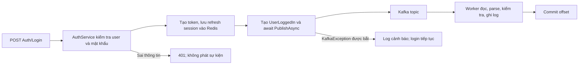

# Kafka trong luồng đăng nhập INuStore

## Bài toán và các thành phần

Sau khi đăng nhập thành công, API cần phát tín hiệu để một tiến trình khác biết người dùng vừa đăng nhập. Thay đổi lần này dùng **Kafka** làm message broker: API là *producer* (bên gửi), Kafka lưu bản ghi trong *topic* (luồng bản ghi), và `INuStore.NotificationWorker` là *consumer* (bên đọc). Đây là bản demo học tập: Worker hiện chỉ ghi log sự kiện, **chưa gửi email** dù tên project là NotificationWorker. Trước thay đổi này, `AuthService.LoginAsync` gọi `IEmailSender` trực tiếp; lớp gửi email vẫn còn trong Infrastructure nhưng luồng đăng nhập mới không dùng nó.

`UserLoggedIn` trong `src/INuStore.Contract/Messaging/V1/UserLoggedIn.cs` là hợp đồng sự kiện gồm `MessageId`, `UserId`, `UserName`, `Email`, `OccurredAtUtc`. UseCase chỉ biết `IUserLoginEventPublisher`; `KafkaUserLoginEventPublisher` và `UserLoggedInConsumer` nằm trong Infrastructure. Cách đặt này giữ mã nghiệp vụ độc lập với thư viện Kafka. Infrastructure tham chiếu `Confluent.Kafka` phiên bản `2.16.0`; Worker tham chiếu Infrastructure và dùng .NET 10.

Kafka phù hợp khi muốn tách một công việc phát sinh sau đăng nhập khỏi nơi xử lý HTTP, để consumer có thể chạy riêng. Đổi lại phải quản lý broker, topic, offset, lỗi và khả năng xử lý trùng. Với tác vụ rất nhỏ không cần xử lý bất đồng bộ hoặc mở rộng độc lập, gọi trực tiếp vẫn đơn giản hơn.

## Cấu hình hiện tại và lý do

`src/INuStore.API/appsettings.Development.json` và `src/INuStore.NotificationWorker/appsettings.Development.json` cùng khai báo:

```json
"Kafka": {
  "BootstrapServers": "localhost:9092",
  "UserLoggedInTopic": "inustore.user-logged-in",
  "ConsumerGroupId": "inustore-notification-worker"
}
```

`BootstrapServers` là địa chỉ ban đầu để client tìm cluster; `localhost:9092` chỉ phù hợp khi API, Worker và broker đều truy cập được địa chỉ này. Dùng biến môi trường như `Kafka__BootstrapServers` cho địa chỉ khác. Hai tiến trình phải trỏ tới cùng cluster và topic; `ConsumerGroupId` được Worker dùng để chia partition và lưu tiến độ đọc, còn API không dùng giá trị này. `KafkaOptions` bind section `Kafka` và kiểm tra giá trị bắt buộc khi host khởi động qua `ValidateOnStart()` trong `KafkaServiceCollectionExtensions`.

| Thiết lập trong source | Tác dụng và giới hạn |
| --- | --- |
| Producer: `MessageTimeoutMs = 3000` | Giới hạn thời gian thử giao bản ghi; nếu Kafka chậm/không sẵn sàng, việc `await ProduceAsync` vẫn có thể làm tăng độ trễ login. Đây là timeout giao bản ghi, không phải hàng đợi bền vững để thử lại sau. |
| Producer: `EnableIdempotence = true` | Giảm trùng lặp do producer thử gửi lại trong phạm vi cơ chế Kafka. Không làm toàn bộ luồng SQL → Kafka → Worker thành exactly-once. |
| Producer/consumer: `AllowAutoCreateTopics = false` | Không dựa vào broker tự tạo topic ngầm. Worker kiểm tra metadata và chủ động tạo topic nếu thiếu. |
| Consumer: `AutoOffsetReset = Earliest` | Khi nhóm chưa có offset hợp lệ, đọc từ bản ghi cũ nhất còn được giữ. Khi đã có offset hợp lệ, tiếp tục từ offset đã commit; không đọc lại từ đầu mỗi lần khởi động. |
| Consumer: `EnableAutoCommit = false` | Worker tự gọi `Commit(result)` sau khi parse, kiểm tra dữ liệu và ghi log; tránh commit tự động trước các bước này. Commit là thao tác đồng bộ nên có chi phí I/O. |

Theo [tài liệu .NET client của Confluent](https://docs.confluent.io/kafka-clients/dotnet/2.16/overview.html), group chia partition giữa các consumer; `AutoOffsetReset` chỉ áp dụng khi thiếu offset hợp lệ, và commit thủ công sau xử lý có thể đọc lại bản ghi nếu tiến trình dừng trước commit. `EnableIdempotence` áp dụng cho producer, không thay thế tính nguyên tử giữa database và Kafka ([Confluent ProducerConfig](https://docs.confluent.io/platform/current/clients/confluent-kafka-dotnet/_site/api/Confluent.Kafka.ProducerConfig.html)).

Ở `UserLoggedInConsumer.EnsureTopicAsync`, Worker lấy metadata rồi tạo topic với **1 partition, replication factor 1** nếu chưa tồn tại. Đây là cấu hình demo cho một broker; một partition cũng giới hạn mức song song của các consumer cùng group trên topic này. Nếu topic đã có sẵn, Worker không đổi partition hoặc replication factor. Worker cần quyền tạo topic khi thiếu; nếu cluster không cấp quyền, hãy provision topic trước khi chạy. Producer không tạo topic.

## Luồng chạy và nhánh lỗi



`AuthController.Login` trả `Result<Response.Authenticated>` khi `AuthService.LoginAsync` xong. `PublishAsync` serialize sự kiện thành JSON, dùng `UserId` dạng chuỗi làm key và gọi `ProduceAsync`. Key tạo cơ sở giữ thứ tự cho cùng user khi topic có nhiều partition; topic hiện chỉ có một partition. `MessageId` được sinh bằng `Guid.NewGuid()` cho từng lần login, thời điểm dùng `DateTimeOffset.UtcNow`. Lớp publisher chỉ bắt `KafkaException`, ghi warning không kèm payload rồi cho login tiếp tục; lỗi khác, kể cả hủy request, không nằm trong nhánh này. Biến delivery hiện được nhận nhưng không dùng.

`TransactionMiddleware` mở SQL transaction cho `POST` trước controller, rồi chỉ save/commit sau khi controller hoàn tất và HTTP status dưới 400. Vì vậy `PublishAsync` chạy **trước khi SQL transaction của request kết thúc**; Kafka và SQL không cùng một transaction. Login chủ yếu đọc SQL, còn refresh session được ghi vào Redis trước publish. Nếu bước sau đó thất bại, sự kiện có thể đã xuất hiện dù HTTP không thành công. Ngược lại, nếu Kafka ném `KafkaException`, login vẫn có thể trả 200 nhưng không có sự kiện. Không có outbox hoặc retry bền vững trong source hiện tại.

Worker là `BackgroundService`: lúc khởi động kiểm tra/tạo topic, sau đó `Subscribe`, `Consume`, deserialize và kiểm tra các trường bắt buộc, ghi log rồi `Commit`. Với lỗi consume không fatal, Worker đợi một giây và thử lại. JSON sai, dữ liệu thiếu, lỗi commit hoặc lỗi khác làm Worker log loại exception rồi dừng; bản ghi lỗi không được commit theo đường đi này và có thể chặn tiến độ partition khi Worker khởi động lại. `Commit` sau ghi log chỉ xác nhận đã **ghi log**, không xác nhận đã gửi notification. Nếu Worker dừng sau ghi log nhưng trước commit, bản ghi có thể được xử lý lại.

## Chạy thử ở Development

1. Chuẩn bị Kafka có thể truy cập từ cả API và Worker. Ví dụ local dùng `localhost:9092`; khi chạy khác máy/container, đặt `Kafka__BootstrapServers` phù hợp cho từng tiến trình. Không có cấu hình Docker/Compose cho Kafka trong repo.
2. Chạy Worker từ repository root: `dotnet run --project src/INuStore.NotificationWorker -- --environment Development`. Worker sẽ tìm hoặc tạo topic; profile Visual Studio của project cũng đặt `DOTNET_ENVIRONMENT=Development`.
3. Chạy API với SQL Server, Redis, JWT và cấu hình ứng dụng đã chuẩn bị, rồi gửi request `POST /api/v1/Auth/Login` theo `src/INuStore.API/INuStore.API.http`. **API Development tự áp dụng EF migrations khi khởi động**, nên phải xác nhận database đích trước khi chạy.
4. Với login hợp lệ, dự kiến nhận token từ API và thấy Worker log `Received login event` cùng `MessageId`/`UserId`. Publisher hiện không ghi log khi gửi thành công, nên không thể đối chiếu `MessageId` giữa log API và Worker như ghi chú trong file `.http` đang gợi ý. Nếu Kafka lỗi được bắt, API ghi warning và login vẫn tiếp tục.

Các lệnh trên là hướng dẫn cho người đọc; bài này không xác nhận đã chạy broker, API hay Worker.

## Best practices cho production và hướng cải thiện

- **Đảm bảo không mất sự kiện:** Nếu notification là yêu cầu nghiệp vụ, ghi outbox record cùng SQL transaction, rồi một publisher riêng chuyển từ outbox sang Kafka. Thiết kế cách xử lý trùng bằng `MessageId`; outbox không tự loại bỏ việc consumer chạy lại.
- **Xử lý thực tế trước commit:** Thêm notification handler và chỉ commit sau khi xử lý thành công. Dùng `MessageId` để tránh gửi trùng khi Worker xử lý lại. Quy định retry/backoff và dead-letter topic hoặc cơ chế cách ly bản ghi lỗi, tránh một JSON hỏng chặn cả partition.
- **Quản lý topic ngoài ứng dụng:** Provision partition, replication factor, retention và ACL theo môi trường; không phụ thuộc quyền tạo topic của Worker. Chọn số partition theo nhu cầu throughput và số consumer đo được. `replication factor 1` không chịu được mất broker lưu bản sao duy nhất.
- **Bảo vệ dữ liệu:** Event hiện mang `UserName` và `Email`. Chỉ giữ trường consumer thực sự cần, hạn chế ghi payload, cấu hình xác thực/mã hóa kết nối Kafka khi triển khai ngoài máy local, và quản lý vòng đời dữ liệu/retention.
- **Quan sát lỗi và độ trễ:** Theo dõi publish failure, consumer lag, lỗi deserialize/commit và thời gian `ProduceAsync` làm chậm login. Đặt hành vi khi Kafka không sẵn sàng theo mức quan trọng của notification; hiện source ưu tiên login tiếp tục khi bắt được `KafkaException`.

Các mục này là **đề xuất**, chưa được triển khai trong thay đổi hiện tại.

## Câu hỏi phỏng vấn senior

1. Vì sao `EnableIdempotence` của producer không đảm bảo mỗi lần login chỉ gửi một notification?
2. Sự kiện có thể xuất hiện trước SQL commit ở luồng hiện tại như thế nào, và outbox giải quyết phần nào của vấn đề?
3. Khi Worker ghi log xong nhưng dừng trước `Commit`, điều gì xảy ra sau khi khởi động lại?
4. `AutoOffsetReset.Earliest` có khiến Worker đọc lại toàn bộ topic sau mọi lần restart không? Vì sao?
5. Với một partition và nhiều Worker cùng group, giới hạn xử lý song song là gì? Khi nào nên tăng partition?
6. Bạn sẽ xử lý một event JSON lỗi liên tục mà vẫn giữ khả năng theo dõi và không bỏ qua sự kiện hợp lệ như thế nào?
