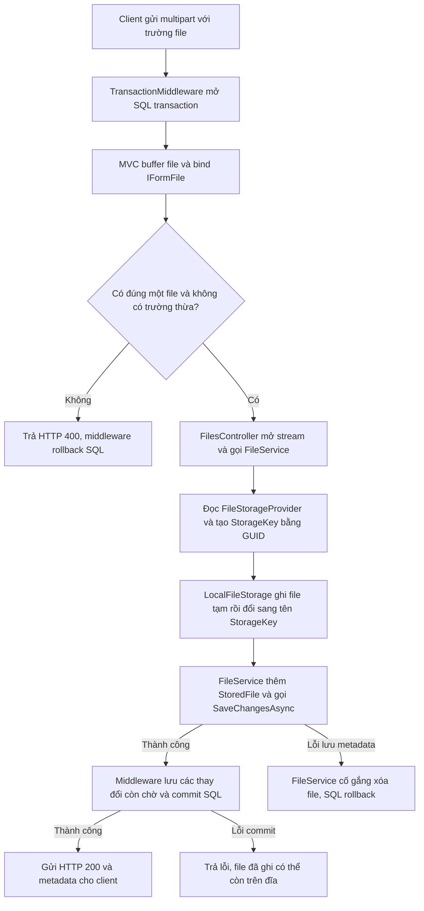

# Upload file trong ASP.NET Core

## Khi nào cần upload file?

Ví dụ, người dùng gửi ảnh đại diện lên API. Client gửi một request `multipart/form-data`; mỗi *part* chứa một trường hoặc một file. ASP.NET Core có thể **buffer** file để action nhận qua `IFormFile`, hoặc ứng dụng tự đọc từng part bằng **streaming**. `IFormFile` là đối tượng đại diện cho file trong request, chưa phải file đã được lưu lâu dài. [Microsoft Learn: Upload files in ASP.NET Core](https://learn.microsoft.com/en-us/aspnet/core/mvc/models/file-uploads?view=aspnetcore-11.0#file-upload-scenarios).

Luồng cơ bản: client gửi form → server đọc và kiểm tra giới hạn request → API nhận file → kiểm tra nội dung và quyền truy cập → ghi vào nơi lưu trữ → trả kết quả. Chỉ bước ghi vào nơi lưu trữ mới tạo bản lưu lâu dài; model binding `IFormFile` có thể đã dùng RAM hoặc file tạm trước khi action chạy.

## Chọn nơi lưu trữ

| Nơi lưu | Lợi ích | Đổi lại / khi cân nhắc |
| --- | --- | --- |
| Database | Có thể lấy metadata và nội dung file cùng một bản ghi; thuận tiện với file nhỏ như avatar. | Dữ liệu nhị phân lớn làm database, backup và truy vấn nặng hơn; phải đo với tải thực tế. |
| File system hoặc network share | Dễ ghi/đọc bằng stream; có thể tách nội dung file khỏi SQL, chỉ lưu metadata trong SQL. | Phải quản lý quyền thư mục, sao lưu, dung lượng và đồng bộ khi chạy nhiều instance. |
| Object/cloud storage, ví dụ Azure Blob Storage | Có dịch vụ chuyên cho lưu trữ và mở rộng; ứng dụng có thể chỉ lưu khóa file trong SQL. | Cần quản lý chi phí, quyền truy cập, mạng và vòng đời dữ liệu. |

Microsoft Learn trình bày cả ba cách; không có cách nào mặc nhiên tốt nhất cho mọi hệ thống. Với INuStore, chưa có yêu cầu về loại, kích thước, lưu lượng và thời gian giữ file nên **chưa thể chốt nơi lưu**. [Microsoft Learn: Storage scenarios](https://learn.microsoft.com/en-us/aspnet/core/mvc/models/file-uploads?view=aspnetcore-11.0#storage-scenarios).

## Buffering và streaming

| Cách | Cơ chế | Phù hợp khi | Chi phí cần nhớ |
| --- | --- | --- | --- |
| `IFormFile` (buffering) | Model binding đọc file vào RAM hoặc file tạm trước khi action xử lý. | File nhỏ, số request đồng thời vừa phải; muốn code đơn giản. | Nhiều upload đồng thời có thể làm đầy RAM/ổ tạm. |
| `MultipartReader` (streaming) | Ứng dụng đọc từng section của request và chuyển tiếp vào stream đích. | File lớn hoặc tải đồng thời làm buffering tốn tài nguyên. | Phải tự xử lý multipart, giới hạn kích thước, validation và lỗi giữa chừng. |

Streaming **giảm nhu cầu RAM và ổ tạm**, không mặc nhiên làm upload nhanh hơn. Ngưỡng “nhỏ/lớn” phụ thuộc hạ tầng và tải thực tế.

| Cấu hình / thành phần | Giá trị mặc định theo Microsoft Learn | Tác dụng |
| --- | --- | --- |
| `MemoryBufferThreshold` | 64 KB | File buffered vượt ngưỡng này được chuyển từ RAM sang file tạm. |
| `MultipartBodyLengthLimit` | 128 MB | Giới hạn cho **mỗi multipart body** khi parse form. |
| Kestrel `MaxRequestBodySize` | 30.000.000 byte (khoảng 28,6 MiB) | Giới hạn **toàn bộ HTTP request**, gồm cả các phần form và overhead. |
| `ASPNETCORE_TEMP` | Không có giá trị cố định | Nếu đặt thì dùng thư mục này cho file tạm; nếu không, dùng thư mục temp của tài khoản chạy ứng dụng. |

Vì 128 MB là giới hạn multipart còn Kestrel mặc định chặn request lớn hơn khoảng 28,6 MiB, không thể suy ra API nhận được file 128 MB. Reverse proxy hoặc IIS có thể chặn sớm hơn. Các giá trị trên là **mặc định trong tài liệu**, không phải cấu hình upload riêng của INuStore. [Microsoft Learn: mặc định form](https://learn.microsoft.com/en-us/aspnet/core/mvc/models/file-uploads?view=aspnetcore-11.0#small-and-large-files), [server và app configuration](https://learn.microsoft.com/en-us/aspnet/core/mvc/models/file-uploads?view=aspnetcore-11.0#server-and-app-configuration).

## Ví dụ buffered upload bằng Web API

HTML form phải dùng `multipart/form-data`; tên trường `file` cần khớp tên model/parameter được bind. Nếu thiếu `enctype` hoặc tên trường không khớp, `IFormFile` có thể là `null`. [Microsoft Learn: form và lỗi binding](https://learn.microsoft.com/en-us/aspnet/core/mvc/models/file-uploads?view=aspnetcore-11.0#troubleshoot).

```html
<form method="post" enctype="multipart/form-data">
    <input type="file" name="file" />
    <button type="submit">Gửi</button>
</form>
```

Đoạn action sau là **ví dụ độc lập để học cơ chế**, không phải endpoint đang có trong INuStore. Giả sử controller đã có `storageDirectory`: đường dẫn tuyệt đối tới thư mục upload riêng, được cấu hình và cấp quyền ghi trước khi nhận request. Giới hạn minh họa là 5 MiB cho file và 6 MiB cho request để chừa chỗ cho multipart overhead:

```csharp
[HttpPost("upload")]
[RequestSizeLimit(6 * 1024 * 1024)]
[RequestFormLimits(MultipartBodyLengthLimit = 6 * 1024 * 1024)]
public async Task<IActionResult> Upload(
    [FromForm] IFormFile? file,
    CancellationToken cancellationToken)
{
    const long maxFileSize = 5 * 1024 * 1024;
    if (file is null || file.Length == 0 || file.Length > maxFileSize)
    {
        return BadRequest("File is missing, empty, or too large.");
    }

    var storedName = Path.GetRandomFileName();
    var path = Path.Combine(storageDirectory, storedName);

    await using var output = new FileStream(path, FileMode.CreateNew, FileAccess.Write);
    await file.CopyToAsync(output, cancellationToken);

    return Ok(new { storedName });
}
```

`[FromForm]` cho MVC biết lấy `file` từ multipart form. Hai attribute giới hạn phần form và toàn request, nhưng còn có thể có giới hạn ở hạ tầng phía trước. Kiểm tra `Length` là kiểm tra nghiệp vụ sau model binding; nó **không thay thế** giới hạn request. `Path.GetRandomFileName()` tạo tên lưu do server chọn; `FileMode.CreateNew` không ghi đè file trùng tên. `CopyToAsync` mới thực hiện I/O ghi file, và token giúp hủy thao tác khi request bị hủy. Response `storedName` chỉ là kết quả minh họa; API thực tế phải xem xét quyền tải lại file. [Microsoft Learn: buffered upload](https://learn.microsoft.com/en-us/aspnet/core/mvc/models/file-uploads?view=aspnetcore-11.0#upload-small-files-with-buffered-model-binding-to-physical-storage), [request limits](https://learn.microsoft.com/en-us/aspnet/core/mvc/models/file-uploads?view=aspnetcore-11.0#server-and-app-configuration).

Ví dụ này **chưa đủ cho production**: chưa xác thực người gọi, chưa kiểm tra extension/chữ ký file, chưa quét malware, chưa xử lý va chạm tên ngẫu nhiên hoặc xóa file ghi dở khi `CopyToAsync` thất bại. Không nên sao chép nguyên action này vào project. INuStore đặt request validation trong FluentValidation validator và `[Validate<TModel>]`; nếu triển khai thật, cần giữ quy ước đó thay vì để toàn bộ kiểm tra trong controller.

### Streaming upload xử lý khác ở đâu?

Với file lớn, action có thể đọc `Request.Body` bằng `MultipartReader`. Nó lấy *boundary* từ `Content-Type`, đọc từng `MultipartSection`, xác định section nào là file, rồi copy nội dung sang stream đích theo từng phần. Không bind request đó vào `IFormFile`, vì như vậy framework đã buffer file trước khi action bắt đầu. Đoạn chính trong tài liệu Microsoft dùng `ReadNextSectionAsync(cancellationToken)` rồi `section.Body.CopyToAsync(outputStream, cancellationToken)`; trước khi đưa vào production phải áp dụng giới hạn byte khi copy, kiểm tra header/section và dọn file ghi dở. [Microsoft Learn: streaming upload](https://learn.microsoft.com/en-us/aspnet/core/mvc/models/file-uploads?view=aspnetcore-11.0#upload-large-files-with-streaming).

## Validation và bảo mật

| Kiểm tra | Vì sao cần | Điểm thực hiện |
| --- | --- | --- |
| Kích thước file và request | Chống cạn RAM, ổ tạm/ổ lưu trữ và DoS. | Giới hạn server/form trước action; giới hạn nghiệp vụ phía server. |
| Extension cho phép | Loại những kiểu file không thuộc yêu cầu sản phẩm. | Kiểm tra phía server, không chỉ ở input HTML. |
| File signature | Một file đổi tên thành `.jpg` vẫn có thể không phải JPEG. | Đọc các byte đầu theo đặc tả định dạng được hỗ trợ. |
| Tên file | `IFormFile.FileName` do client kiểm soát, có thể chứa path. | Tạo tên lưu mới; tên gốc chỉ dùng để hiển thị/log sau khi bỏ path và HTML encode. |
| Malware | File hợp lệ về extension/signature vẫn có thể độc hại. | Quét trước khi cho người dùng hoặc hệ thống khác truy cập; có thể giữ file trong vùng cách ly. |

`Content-Type` của part cũng do client gửi, không phải bằng chứng đủ về loại file. Đặt thư mục upload ngoài cây ứng dụng, không cho phép thực thi file, và kiểm tra quyền của cả thao tác upload lẫn tải xuống. Việc quét malware có thể tốn thời gian; với lưu lượng lớn, Microsoft nêu cách cách ly file rồi quét nền trước khi công khai. [Microsoft Learn: security considerations](https://learn.microsoft.com/en-us/aspnet/core/mvc/models/file-uploads?view=aspnetcore-11.0#security-considerations), [validation](https://learn.microsoft.com/en-us/aspnet/core/mvc/models/file-uploads?view=aspnetcore-11.0#validation).

## Áp dụng vào INuStore

### Luồng upload Buffered hiện tại

Client gửi `POST /api/v1/files/buffered` với `multipart/form-data` gồm một trường file tên `file`. MVC đọc và buffer nội dung trong bộ nhớ hoặc file tạm, rồi truyền `IFormFile` cho controller.



- [FilesController](../src/INuStore.API/Controllers/FilesController.cs) nhận `IFormFile`, kiểm tra form và mở stream. Nội dung có thể đã được MVC buffer trước khi action chạy.
- [FileService](../src/INustore.UseCase/UseCases/V1/FileService/FileService.cs) đọc cấu hình `FileStorageProvider` từ SQL và chọn provider đã đăng ký. [LocalFileStorage](../src/INuStore.Infrastructure/Storage/LocalFileStorage.cs) dùng tên do server tạo. `OriginalFileName` được lưu trong metadata để hiển thị, còn `StorageKey` xác định tên file trên đĩa. Nếu ghi nội dung lỗi hoặc bị hủy giữa chừng, storage cố gắng xóa file tạm.
- [TransactionMiddleware](../src/INuStore.API/Middlewares/TransactionMiddleware.cs) giữ response đến khi commit thành công. `SaveChangesAsync` trong service ghi metadata trong transaction đang mở. Nếu commit lỗi sau khi service đã trả kết quả, khối dọn file của service không còn chạy. Rollback SQL chỉ hoàn tác dữ liệu trong SQL Server, nên file trên đĩa có thể cần được đối soát và dọn riêng.

## Best practices cho production

- **Giới hạn ở nhiều lớp:** đặt kích thước file theo nghiệp vụ, giới hạn multipart và tổng request, đồng thời kiểm tra reverse proxy/IIS nếu triển khai qua chúng. Không nâng giới hạn toàn API chỉ để phục vụ một endpoint. [Microsoft Learn: request limits](https://learn.microsoft.com/en-us/aspnet/core/mvc/models/file-uploads?view=aspnetcore-11.0#request-body-size-limits-summary).
- **Cách ly nơi lưu:** dùng thư mục riêng ngoài cây ứng dụng, không cho thực thi file; tạo tên lưu trữ do server quyết định. Kiểm tra quyền người gọi khi upload **và** khi tải xuống. [Microsoft Learn: security considerations](https://learn.microsoft.com/en-us/aspnet/core/mvc/models/file-uploads?view=aspnetcore-11.0#security-considerations).
- **Kiểm tra nội dung trước khi công khai:** quét malware và cân nhắc vùng cách ly; với tải lớn có thể quét nền rồi mới cho tải file. Đây là đề xuất chưa áp dụng trong INuStore. [Microsoft Learn: content validation](https://learn.microsoft.com/en-us/aspnet/core/mvc/models/file-uploads?view=aspnetcore-11.0#content-validation).
- **Đo trên tải thật:** theo dõi RAM, ổ tạm, thời gian upload và số request đồng thời trước khi chọn buffering hay streaming. [Microsoft Learn: small and large files](https://learn.microsoft.com/en-us/aspnet/core/mvc/models/file-uploads?view=aspnetcore-11.0#small-and-large-files).

## Câu hỏi phỏng vấn senior

1. Khi nào bạn chọn `IFormFile`, và dấu hiệu vận hành nào khiến bạn chuyển sang streaming?
2. Vì sao giới hạn `MultipartBodyLengthLimit` đủ lớn mà request vẫn có thể bị Kestrel từ chối?
3. Làm sao ngăn client dùng tên file để ghi ra ngoài thư mục lưu trữ?
4. Bạn kiểm tra loại file thế nào khi đuôi file và `Content-Type` đều do client gửi?
5. Nếu file đã ghi xong nhưng lưu metadata SQL thất bại, bạn xử lý nhất quán và dọn dẹp ra sao?
6. Bạn thiết kế lưu trữ và quét malware thế nào để file chưa an toàn không được tải xuống?
