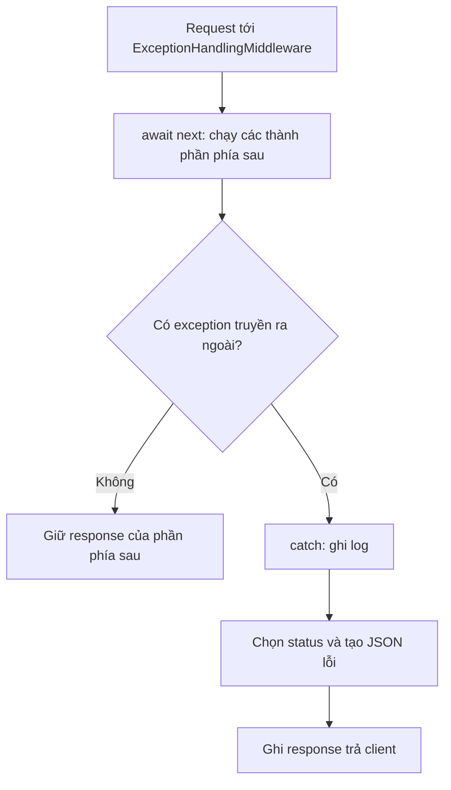

# ExceptionHandlingMiddleware trong INuStore

`ExceptionHandlingMiddleware` bắt exception từ các thành phần phía sau, ghi log và trả HTTP response lỗi. Nhờ đó, controller không cần lặp lại `try/catch` cho cùng một cách xử lý lỗi.

Tài liệu mô tả code hiện tại của project .NET 10. Các phần **đề xuất** chưa được áp dụng vào ứng dụng.

## 1. Middleware làm gì?

Middleware là một bước trong luồng xử lý HTTP request. Nó nhận `HttpContext` chứa request/response và gọi `next` để chạy phần phía sau.

Trong INuStore, trách nhiệm được chia như sau:

- **Service:** phát hiện lỗi nghiệp vụ, ví dụ không tìm thấy user thì throw `UserNotFoundException`.
- **Repository:** truy vấn database; lỗi database có thể truyền ngược lên.
- **Exception middleware:** bắt exception, ghi log và chọn HTTP status cùng JSON trả client.

Việc xử lý HTTP nằm ở API giúp service không phải phụ thuộc `HttpContext`. Middleware này chỉ bắt exception trong phần request pipeline phía sau nó; lỗi startup hoặc background job nằm ngoài phạm vi đó. Xem [ASP.NET Core middleware](https://learn.microsoft.com/en-us/aspnet/core/fundamentals/middleware/?view=aspnetcore-10.0).

## 2. Code nằm ở đâu, đăng ký thế nào?

Class chính: `src/INuStore.API/Middlewares/ExceptionHandlingMiddleware.cs`.

**Code hiện tại:**

```csharp
// Trong AddApi: đăng ký để DI tạo instance.
services.AddTransient<ExceptionHandlingMiddleware>();

// Trong Program.cs: thêm middleware vào request pipeline.
app.UseMiddleware<ExceptionHandlingMiddleware>();
```

Cần cả hai bước: đăng ký DI chưa làm middleware tự chạy. Class triển khai `IMiddleware`, được tạo thông qua DI khi xử lý request. Xem [Factory-based middleware activation](https://learn.microsoft.com/en-us/aspnet/core/fundamentals/middleware/extensibility?view=aspnetcore-10.0).

Trong `Program.cs`, exception middleware đứng trước `TransactionMiddleware` và controller nên bắt được exception từ hai thành phần này. `ConfigureSwagger()` đứng trước exception middleware nên lỗi từ Swagger middleware không được nó bao quanh.

## 3. Vì sao phải await next?

**Code hiện tại trong `InvokeAsync`:**

```csharp
try
{
    await next(context);
}
catch (Exception e)
{
    _logger.LogError(e, e.Message);
    await HandleExceptionAsync(context, e);
}
```

- `next(context)` chuyển request cho phần phía sau, chẳng hạn controller gọi service rồi repository.
- `await` chờ phần đó hoàn tất. Nếu một thao tác được await gặp lỗi và exception truyền ra ngoài, luồng đi vào `catch`.
- `catch` ghi log rồi gọi `HandleExceptionAsync` để tạo response lỗi.

Nếu bỏ `await`, `try/catch` có thể kết thúc trước khi thao tác bất đồng bộ gặp lỗi.



**HTTP lỗi không đồng nghĩa có exception.** Ví dụ filter trả 400 bình thường thì không vào `catch`.

## 4. Exception được chuyển thành response thế nào?

`HandleExceptionAsync` gọi ba method để chọn status, title và errors; lấy `exception.Message` làm detail; sau đó chuyển object thành JSON bằng `JsonSerializer.Serialize` và ghi bằng `Response.WriteAsync`.

### Mapping hiện tại

| Exception | HTTP status | Title |
| --- | --- | --- |
| `InvalidCredentialsException` | 401 | `Authentication Failure` |
| `BadRequestException` hoặc lớp kế thừa | 400 | `DomainException.Title` |
| `NotFoundException` hoặc lớp kế thừa | 404 | `DomainException.Title` |
| `INustore.UseCase.Exceptions.ValidationException` | **500** | `Validation Failure` |
| `FormatException` | 422 | `Server Error` |
| Exception khác chưa được map | 500 | `DomainException.Title` nếu có; còn lại `Server Error` |

`GetErrors` chỉ lấy danh sách lỗi từ UseCase `ValidationException`; các trường hợp khác trả `null`. Exception này hiện thiếu mapping status nên vẫn trả **500**, dù title là `Validation Failure`.

### Ví dụ: user không tồn tại

Request minh họa: `GET /api/v1/User/GetUserById?UserId=9999`. Giả sử request vượt qua policy `allow-gmail`, validation hợp lệ và database không có user này.

`UserService.GetUserById` gọi repository để truy vấn database. Khi kết quả là `null`, service throw `UserNotFoundException`; middleware chuyển thành response dự kiến:

```json
{
  "title": "Not Found",
  "status": 404,
  "detail": "The user with the id 9999 was not found.",
  "errors": null
}
```

Response dùng `Content-Type: application/json`. Với đăng nhập, `AuthService.LoginAsync` throw `InvalidCredentialsException` khi thiếu user hoặc sai password; cả hai nhánh trả 401 với detail `Invalid username or password.` và không tạo token.

### Validation filter có đi vào catch không?

`ValidationFilter<TModel>` trả 400 trực tiếp khi input không hợp lệ, **không throw**, nên không vào `catch`. Đây là nhánh khác với việc service throw UseCase `ValidationException`.

Tương tự, 401/403 từ authentication/authorization không tự đi vào `catch` nếu không có exception. Xem thêm [luồng FluentValidation](2.fluent-validation-flow.MD).

## 5. Quan hệ với transaction

- `TransactionMiddleware` quản lý transaction cho POST, PUT, PATCH và DELETE; GET bỏ qua bước này.
- Khi xử lý xong với status dưới 400, nó gọi `SaveChangesAsync` rồi commit trước khi gửi response. Gọi repository `Add` chưa có nghĩa dữ liệu đã được lưu.
- Khi xử lý xong với status từ 400, nó gọi rollback.
- Nếu có exception trước commit, transaction chưa commit được dispose; exception truyền ra `ExceptionHandlingMiddleware` để ghi log và trả lỗi.
- **Exception middleware không tự rollback.** Nếu database đã commit nhưng gửi response thất bại, dữ liệu vẫn có thể đã được lưu.

## 6. Những điểm nên cải thiện

Code hiện tại đã xử lý lỗi tập trung, nhưng nên sửa các điểm sau trước khi dùng production:

| Điểm hiện tại | Đề xuất |
| --- | --- |
| Trả `exception.Message` cho cả lỗi 500, có thể lộ chi tiết nội bộ | Với 500, trả thông báo chung; giữ chi tiết trong log. |
| Chưa kiểm tra `Response.HasStarted` | Nếu response đã bắt đầu gửi, không cố đổi status hoặc ghi JSON mới; dùng `throw;` trong catch để truyền lỗi ra ngoài. |
| Chưa clear response khi thay bằng response lỗi | Khi response chưa bắt đầu, clear để tránh giữ header/body cũ. |
| UseCase `ValidationException` trả 500 | Map 400 để thống nhất với validation filter hiện tại. |
| Mọi `FormatException` đều trả 422 | Chỉ trả 4xx khi xác định lỗi thuộc input; ưu tiên exception nghiệp vụ cụ thể. |
| Request bị hủy cũng bị coi như lỗi server | Xử lý riêng cancellation do `RequestAborted` đã hủy. |

Microsoft khuyến cáo [không trả thông tin lỗi nhạy cảm](https://learn.microsoft.com/en-us/aspnet/core/fundamentals/error-handling?view=aspnetcore-10.0#produce-a-problemdetails-payload-for-exceptions). Khi headers đã gửi, ứng dụng [không thể đổi HTTP status](https://learn.microsoft.com/en-us/aspnet/core/fundamentals/error-handling?view=aspnetcore-10.0#response-headers).

Về log và response, nên:

- Dùng `Error` cho lỗi hệ thống; chọn mức phù hợp cho lỗi nghiệp vụ dự kiến.
- Thêm `traceId` vào response và log để tra cứu cùng một request. Không ghi password hoặc token vào log.
- Khai báo return type của `GetErrors` là nullable nếu vẫn trả `null`.

## 7. Có nên chuyển sang IExceptionHandler?

`IExceptionHandler` là interface có sẵn của ASP.NET Core để xử lý exception tập trung. `ProblemDetails` là cấu trúc mô tả lỗi HTTP với các field như `title`, `status`, `detail` và phần mở rộng.

| Phương án | Khi phù hợp | Đổi lại |
| --- | --- | --- |
| Giữ custom middleware | Muốn ít thay đổi và giữ JSON hiện tại | Tự bảo trì việc ghi response, cancellation và logging. |
| Dùng `IExceptionHandler` + `ProblemDetails` | Muốn tận dụng xử lý có sẵn và thống nhất response lỗi | Cần chuyển mapping, kiểm tra contract response và logging. |

**Đề xuất cho INuStore:** ưu tiên sửa mục 6. Nếu chuyển sang built-in handler, cần đăng ký `AddExceptionHandler<T>()`, `AddProblemDetails()` và thêm `UseExceptionHandler()` vào pipeline thay cho middleware hiện tại. Chỉ đăng ký DI là chưa đủ. Xem [hướng dẫn IExceptionHandler](https://learn.microsoft.com/en-us/aspnet/core/fundamentals/error-handling?view=aspnetcore-10.0#iexceptionhandler).

Hai lưu ý khi chuyển:

- `IExceptionHandler` là singleton, không inject trực tiếp scoped `DbContext` vào handler.
- Từ .NET 10, diagnostics như log/metrics mặc định bị suppress khi handler trả `true` để báo đã xử lý exception. Cần chủ động chọn cách ghi log. Xem [SuppressDiagnosticsCallback](https://learn.microsoft.com/en-us/aspnet/core/fundamentals/error-handling?view=aspnetcore-10.0#suppressdiagnosticscallback).

Việc chuyển handler không tự đổi response 400 từ validation filter hay 401/403 từ authorization; muốn thống nhất cần cấu hình riêng các nhánh đó.

## 8. Câu hỏi phỏng vấn senior

1. **Thiết kế error handling:** Khi nào bạn dùng exception, khi nào dùng `Result` cho lỗi nghiệp vụ? Làm sao giữ HTTP status, response body và quyết định commit/rollback nhất quán?
2. **Thứ tự middleware:** Vì sao exception middleware cần bao quanh transaction middleware? Nếu đảo thứ tự, điều gì có thể xảy ra khi service hoặc `SaveChangesAsync` ném exception?
3. **Response đã bắt đầu:** Một endpoint streaming đã gửi một phần dữ liệu rồi gặp exception. Bạn xử lý thế nào khi `Response.HasStarted` là `true`, và client nhận biết thất bại bằng cách nào?
4. **Commit thành công nhưng mất response:** Database đã commit nhưng client mất kết nối rồi retry request. Vì sao exception handler không đủ để giải quyết tình huống này? Bạn thiết kế idempotency thế nào để tránh ghi dữ liệu trùng?
5. **Cancellation và timeout:** Bạn phân biệt client hủy request, timeout gọi dịch vụ ngoài và lỗi hệ thống ra sao? Mỗi trường hợp ảnh hưởng thế nào đến cancellation token, transaction, HTTP response và mức log?
6. **Vận hành và thay đổi contract:** Khi chuyển từ custom middleware sang `IExceptionHandler` và `ProblemDetails`, bạn làm sao giữ tương thích cho client, tránh lộ thông tin nhạy cảm và bảo đảm log/trace vẫn đủ để điều tra lỗi trong .NET 10?
