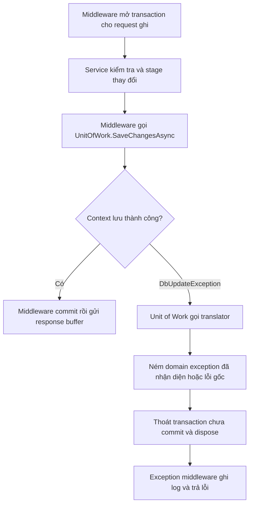

# Chuyển lỗi SQL Server thành lỗi nghiệp vụ và lý do sửa TransactionMiddleware

## 1. Vì sao đã kiểm tra trong service vẫn cần xử lý lỗi database?

Trong INuStore, `RoleService` đã kiểm tra tên role bị trùng và role đang được gán cho user. Tuy nhiên, dữ liệu có thể thay đổi giữa lúc kiểm tra và lúc lưu. Đây là **race condition**: kết quả phụ thuộc vào thứ tự thực thi của các request đồng thời.

Ví dụ minh họa khi hai request cùng tạo role `Support`:

```text
Request A: kiểm tra Support chưa tồn tại → hợp lệ
Request B: kiểm tra Support chưa tồn tại → hợp lệ
Request A: lưu Support                  → thành công
Request B: lưu Support                  → unique index từ chối
```

FluentValidation kiểm tra input; service kiểm tra quy tắc nghiệp vụ; database giữ ràng buộc khi thực sự ghi dữ liệu. Bắt lỗi database giúp API trả thông báo phù hợp cho tình huống xung đột, không thay thế hai bước kiểm tra phía trước.

Code hiện tại dùng .NET 10 và EF Core SQL Server 10.0.14. Ràng buộc tên role là unique index `IX_Roles_Name`; quan hệ `UserRoles.RoleId` dùng foreign key `FK_UserRoles_Roles_RoleId` với `DeleteBehavior.NoAction`. Database hiện có phải được áp dụng migration tương ứng thì mới có các ràng buộc này; chỉ sửa cấu hình EF chưa thay đổi database.

## 2. Các thành phần chịu trách nhiệm gì?

| Thành phần | Trách nhiệm trong luồng hiện tại |
| --- | --- |
| `RoleService` | Kiểm tra nghiệp vụ và stage thay đổi qua repository; không tự lưu hoặc commit. |
| `TransactionMiddleware` | Mở transaction cho POST/PUT/PATCH/DELETE, giữ response trong buffer, gọi lưu rồi commit. |
| `EFUnitOfWork.SaveChangesAsync` | Gọi context để ghi dữ liệu; bắt `DbUpdateException` và yêu cầu chuyển lỗi. |
| `SqlServerExceptionTranslator` | Nhận diện lỗi SQL đã biết và tạo domain exception; không truy vấn hoặc ghi database. |
| `ExceptionHandlingMiddleware` | Ghi log exception và chuyển thành HTTP response. |

Source chính: [SqlServerExceptionTranslator](../src/INuStore.Infrastructure/Exceptions/SqlServerExceptionTranslator.cs), [EFUnitOfWork](../src/INuStore.Infrastructure/EFUnitOfWork.cs) và [TransactionMiddleware](../src/INuStore.API/Middlewares/TransactionMiddleware.cs).

`DbUpdateException` là exception EF Core phát sinh khi lưu dữ liệu thất bại. Trong trường hợp SQL Server đang xét, `InnerException` là `SqlException`; tập `SqlException.Errors` chứa các `SqlError` có mã và thông báo lỗi. Translator kiểm tra từng `SqlError`, không giả định luôn chỉ có một lỗi. Xem [DbUpdateException](https://learn.microsoft.com/en-us/dotnet/api/microsoft.entityframeworkcore.dbupdateexception?view=efcore-10.0).

## 3. Hai nhánh if thực sự làm gì?

**Code hiện tại**, nằm trong vòng lặp qua `sqlException.Errors`:

```csharp
if (IsDuplicateRoleName(error, exception))
{
    return new RoleException.DuplicateRoleNameException(exception);
}

if (IsAssignedRoleDeletion(error, exception))
{
    return new RoleException.RoleAssignedException(exception);
}
```

`error` là lỗi SQL đang xét. `exception` là `DbUpdateException` bao quanh lỗi SQL, cung cấp thêm các entity liên quan tới lần lưu thất bại.

### 3.1. IsDuplicateRoleName: nhận diện vi phạm tên role duy nhất

```csharp
private static bool IsDuplicateRoleName(SqlError error, DbUpdateException exception)
    => error.Number is 2601 or 2627
        && error.Message.Contains($"'{RoleNameIndex}'", StringComparison.Ordinal)
        && exception.Entries.Any(entry => entry.Entity is Role
            && entry.State is EntityState.Added or EntityState.Modified);
```

Ba nhóm điều kiện phải cùng đúng:

| Điều kiện | Ý nghĩa |
| --- | --- |
| Mã `2601` hoặc `2627` | Lỗi liên quan tới khóa trùng: `2601` gắn với unique index, `2627` gắn với ràng buộc khóa duy nhất như PRIMARY KEY/UNIQUE. |
| Message chứa `'IX_Roles_Name'` | Xác định đối tượng bị vi phạm là ràng buộc tên role đang được xử lý. |
| Có entry là `Role`, trạng thái `Added` hoặc `Modified` | Lần lưu thất bại liên quan tới việc thêm hoặc sửa role. |

Mã SQL có ý nghĩa rộng hơn nghiệp vụ. Chỉ thấy `2601` không đủ kết luận tên role bị trùng: một bảng khác cũng có thể có unique index. Code kết hợp mã lỗi, tên index và entity/state để thu hẹp trường hợp nhận diện. Tài liệu Microsoft mô tả [lỗi 2601](https://learn.microsoft.com/en-us/sql/relational-databases/replication/mssql-eng002601?view=sql-server-ver17) và [lỗi 2627](https://learn.microsoft.com/en-us/sql/relational-databases/replication/mssql-eng002627?view=sql-server-ver17).

`RoleNameIndex` hiện có giá trị `IX_Roles_Name`. Cặp dấu nháy đơn trong phép tìm kiếm giúp khớp tên được đặt trong dấu nháy theo định dạng thông báo đang dựa vào; `StringComparison.Ordinal` so sánh chuỗi chính xác, không theo quy tắc ngôn ngữ. Đây là so sánh **thông báo lỗi**, không quyết định cách database so sánh tên role; tính duy nhất của dữ liệu vẫn theo collation của database.

`exception.Entries.Any(...)` duyệt thông tin entity trong bộ nhớ, không chạy SQL mới. `Entries` có thể chứa không, một hoặc nhiều entry; nếu không có entry khớp, điều kiện trả `false`, translator không suy đoán. Xem [DbUpdateException.Entries](https://learn.microsoft.com/en-us/dotnet/api/microsoft.entityframeworkcore.dbupdateexception.entries?view=efcore-10.0).

Khi cả ba nhóm đúng, translator tạo `DuplicateRoleNameException` có message `Role name already exists.`

### 3.2. IsAssignedRoleDeletion: nhận diện xóa role đang được tham chiếu

```csharp
private static bool IsAssignedRoleDeletion(SqlError error, DbUpdateException exception)
    => error.Number == 547
        && error.Message.Contains($"\"{RoleAssignmentForeignKey}\"", StringComparison.Ordinal)
        && exception.Entries.Any(entry => entry.Entity is Role && entry.State == EntityState.Deleted);
```

Điều kiện tương ứng là:

| Điều kiện | Ý nghĩa |
| --- | --- |
| Mã `547` | Câu lệnh vi phạm ràng buộc, có thể là foreign key hoặc CHECK. |
| Message chứa `"FK_UserRoles_Roles_RoleId"` | Xung đột thuộc quan hệ giữa `UserRoles` và `Roles`. |
| Có entry là `Role` đang `Deleted` | Đang cố xóa role, không phải thêm một assignment với RoleId không tồn tại. |

Trong chuỗi C#, `\"` biểu diễn một ký tự dấu nháy kép; dấu gạch chéo ngược không phải ký tự cần tìm trong thông báo. Mã `547` được mô tả trong [bảng lỗi SQL Server 0–999](https://learn.microsoft.com/en-us/sql/relational-databases/errors-events/database-engine-events-and-errors-0-to-999?view=sql-server-ver17#errors-and-events-0-to-999).

Ví dụ minh họa: request A kiểm tra role 6 chưa được gán; request B gán role 6 cho user và lưu thành công; sau đó A xóa role 6. Với foreign key không cascade đã có trong database, SQL Server chặn thao tác xóa. Nếu lỗi và entry khớp các điều kiện trên, translator tạo `RoleAssignedException` với message `Cannot delete a role that is assigned to users.`

`NoAction` không tự gỡ assignment và cũng không bảo vệ quy tắc built-in role. Quy tắc không đổi tên/xóa built-in role vẫn nằm trong service. Hành vi lỗi này đang xét trường hợp SQL Server từ chối thao tác; không khẳng định mọi lỗi quan hệ EF Core đều có `SqlException` và mã `547`.

### 3.3. Vì sao return exception, không throw ngay?

Translator chỉ **nhận diện và tạo exception**. `return` thoát khỏi `Translate` và đưa object về caller, chưa kích hoạt luồng xử lý exception.

**Code hiện tại trong EFUnitOfWork:**

```csharp
catch (DbUpdateException exception)
{
    var translatedException = SqlServerExceptionTranslator.Translate(exception);
    if (translatedException is not null)
    {
        throw translatedException;
    }

    throw;
}
```

Unit of Work mới là nơi `throw` exception đã chuyển. Nếu không có inner `SqlException` hoặc không khớp quy tắc nào, translator trả `null`; `throw;` ném lại exception ban đầu và giữ stack trace. Không dùng `throw exception;` vì cách đó làm thay đổi thông tin stack trace. Xem [hướng dẫn rethrow exception](https://learn.microsoft.com/en-us/dotnet/standard/exceptions/best-practices-for-exceptions#capture-and-rethrow-exceptions-properly).

Hai constructor nhận `exception` giữ nguyên chuỗi nguyên nhân:

```text
DuplicateRoleNameException hoặc RoleAssignedException
└── InnerException: DbUpdateException
    └── InnerException: SqlException
```

Logger có thể ghi nguyên nhân kỹ thuật, còn API trả message của domain exception. Cả hai exception kế thừa `BadRequestException`, nên middleware hiện tại trả **HTTP 400**; translator không tự đặt HTTP status.

Ví dụ response dự kiến khi lỗi trùng tên được nhận diện:

```json
{
  "title": "Bad Request",
  "status": 400,
  "detail": "Role name already exists.",
  "errors": null
}
```

Đây là ví dụ suy ra từ mapping hiện tại, không phải kết quả kiểm thử SQL Server trong bài. Xem thêm [ExceptionHandlingMiddleware](6.exception-handling-middleware.MD).

## 4. Vì sao phải sửa TransactionMiddleware?

Trước khi refactor, middleware gọi context trực tiếp:

```csharp
// Cách gọi trước khi refactor.
await _dbContext.SaveChangesAsync(cancellationToken);
```

Khi `try/catch` được chuyển sang `EFUnitOfWork`, lời gọi trên sẽ bỏ qua nó. Middleware vì vậy được đổi thành:

```csharp
// Code hiện tại: thay lời gọi lưu cũ, không thêm một lần lưu.
await _unitOfWork.SaveChangesAsync(cancellationToken);
await transaction.CommitAsync(cancellationToken);
```

Unit of Work vẫn gọi `_context.SaveChangesAsync` bên trong. Middleware giữ `_dbContext` để mở transaction, đồng thời nhận `IUnitOfWork` để đi qua đầu mối lưu và chuyển lỗi. DI hiện tại dùng context theo request qua `AddDbContextPool<DbContext, ApplicationDbContext>`; các instance Unit of Work transient và repository vẫn phải dùng context chung của request. Không được tự tạo context thứ hai cho lần lưu này.



Sơ đồ tập trung nhánh ghi có status dưới 400. Trong code còn nhánh controller/filter trả status từ 400 trở lên: middleware rollback trực tiếp và không gọi lưu. GET bỏ qua transaction middleware.

Vị trí mới giúp `ApplicationDbContext` tập trung vào model/persistence, Unit of Work tập trung vào lưu, còn các quy tắc nhận diện SQL nằm ở một class trong Infrastructure. Lời gọi trực tiếp tới `DbContext.SaveChanges` hoặc `SaveChangesAsync`, như seeding hiện có, vẫn bỏ qua translator. Lỗi tại `BeginTransactionAsync` hoặc `CommitAsync` cũng không được khối `catch` quanh lần lưu này xử lý.

## 5. Đổi cách gọi lưu có làm commit hai lần không?

Không. `SaveChangesAsync` gửi thay đổi tới database; `CommitAsync` xác nhận transaction đang mở. Thay lời gọi trực tiếp bằng Unit of Work không tăng số lần lưu hay mở thêm transaction.

| Tình huống | Nếu bước sau lỗi thì dữ liệu đã lưu trước đó thế nào? |
| --- | --- |
| Nhiều lần SaveChanges trong cùng transaction, chưa commit; lỗi truyền ra và transaction bị rollback/dispose | Các thay đổi trong transaction đó bị rollback. |
| Nhiều lần SaveChanges không có transaction chung | Lần lưu trước có thể đã commit, không bị rollback bởi lỗi lần sau. |
| Transaction trước đã commit | Lỗi transaction sau không hoàn tác phần đã commit. |

Theo code hiện tại, service chỉ stage thay đổi và middleware lưu một lần trước commit. Nếu có exception trước commit, `await using` dispose transaction chưa commit; `finally` khôi phục response body, rồi exception đi ra middleware ngoài. Exception middleware không tự rollback database. EF Core có thể dùng savepoint khi lưu trong transaction; rollback về savepoint của một lần lưu khác với rollback toàn bộ transaction. Xem [transaction và savepoints trong EF Core](https://learn.microsoft.com/en-us/ef/core/saving/transactions).

Không bắt và nuốt lỗi trong service rồi tiếp tục trả thành công. Sau rollback, không nên tái sử dụng context để retry tùy tiện: rollback database không tự khôi phục toàn bộ trạng thái entity trong bộ nhớ. Nếu đã commit rồi mới lỗi khi gửi response, dữ liệu có thể vẫn được lưu; không có rollback tự động cho transaction đã commit.

## 6. Best practices cho production

- **Code đã làm:** giữ kiểm tra service và ràng buộc database; translator chỉ chuyển các lỗi có đủ dấu hiệu nhận diện, lỗi khác được ném tiếp. Chưa nhận diện không đồng nghĩa dữ liệu được lưu: database vẫn từ chối thao tác vi phạm.
- **Code đã làm:** giữ `InnerException` cho diagnostics, dùng message nghiệp vụ cho hai lỗi được chuyển. Với lỗi chưa nhận diện, middleware hiện tại mặc định trả 500 và dùng `exception.Message`; nên trả thông báo chung cho lỗi 500 để tránh lộ chi tiết nội bộ. Đây là đề xuất chưa áp dụng trong refactor này.
- **Giới hạn hiện tại:** tên constraint được tìm trong message SQL Server. Cần kiểm chứng lại nếu đổi tên index/foreign key hoặc đổi định dạng/ngôn ngữ thông báo. Không mở rộng thành “mọi lỗi 547 đều là role đang được gán”.
- **Đề xuất kiểm chứng với SQL Server:** kiểm tra tạo/sửa tên trùng, xóa role vừa được gán, vi phạm constraint khác không bị nhận nhầm và rollback sau nhiều lần lưu trong transaction chung. Build và test không dùng SQL Server chưa chứng minh được các tình huống đó.
- **Khi thêm quy tắc:** bổ sung hàm điều kiện có tên rõ trong translator, kiểm tra mã lỗi + constraint + entity/state phù hợp, rồi tạo exception giữ nguyên nguyên nhân. Không đưa EF Core hoặc `SqlException` vào UseCase/Domain để nhận diện lỗi.

## 7. Câu hỏi phỏng vấn senior

1. Vì sao kiểm tra tên trùng bằng truy vấn trước khi thêm dữ liệu vẫn không thay thế được unique index khi có request đồng thời?
2. Khi nào lỗi 547 không nên chuyển thành `RoleAssignedException`, dù message có cùng tên foreign key?
3. Nếu SQL Server đổi ngôn ngữ thông báo hoặc index được đổi tên, bạn phát hiện và kiểm soát ảnh hưởng tới translator thế nào?
4. Khi lần SaveChanges thứ hai thất bại, rollback về savepoint khác gì rollback toàn bộ transaction và trạng thái entity trong context cần được xử lý ra sao?
5. Vì sao middleware phải gọi Unit of Work sau khi chuyển try/catch khỏi DbContext? Một job nền gọi context trực tiếp sẽ có hành vi gì?
6. Làm thế nào giữ exception gốc đủ cho điều tra lỗi nhưng không để response hoặc log làm lộ dữ liệu nhạy cảm?
